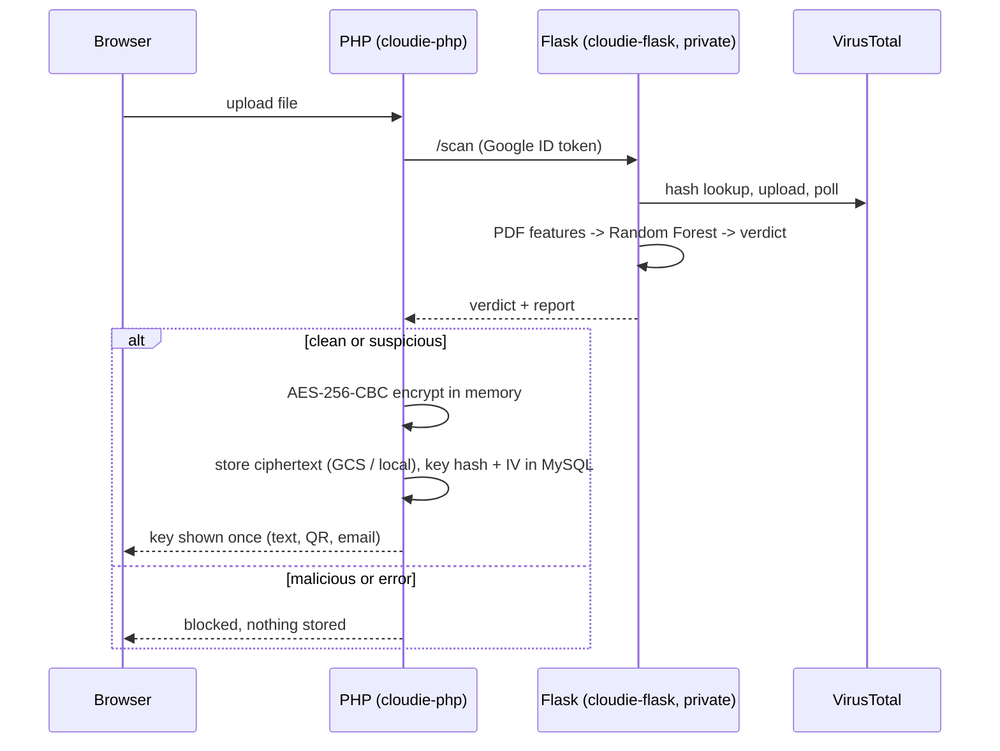

# Cloudie

**Secure cloud storage that scans every file for malware before it encrypts and stores it.**

Final Year Project (CSP650), BSc (Hons) Netcentric Computing, UiTM Shah Alam.
Author: Muhammad Aqeef bin Azhar. Supervisor: Dr. Fakariah Hani Binti Mohd Ali.

Every upload is checked by **VirusTotal** (primary detector) and a **Random Forest** PDF model
(supporting signal), then encrypted with **AES-256-CBC** using a random key per file. The server
never stores the key, only its SHA-256 fingerprint.

## How an upload is judged

| VirusTotal | AI (PDF only) | Result | Stored? |
|---|---|---|---|
| flags the file | any | **Malicious** | No, blocked |
| no result (key missing, rate limit, timeout) | any | **Error** (fail closed) | No, blocked |
| clean | score >= 50% **and** a strong risk indicator (or score >= 85%) | **Suspicious** | Yes, tagged |
| clean | otherwise | **Clean** | Yes |

- Non-PDF files skip the AI and are judged by VirusTotal alone.
- The AI can never block a file by itself. Each report has a **"Why this AI score"** card showing which
  PDF features pushed the score up or down (exact decomposition of the model's score).



## Features

- Upload scan: VirusTotal (hash lookup, upload, polling) + 32-feature Random Forest, explainable
- AES-256-CBC per file: random 32-byte key and 16-byte IV, only `sha256(key)` is stored
- Integrity check after decryption (SHA-256 recorded at upload), tampered files are not served
- Accounts: email verification, password + emailed one-time code (2FA), bcrypt, CSRF
- Rate limiting (login, OTP, register, upload), security headers, `Secure` cookies on HTTPS
- **Tamper-evident audit trail**: every event is sealed into a per-user hash chain (HMAC-SHA256 with a server secret);
  the *Audit trail* page re-verifies it live and pinpoints an edited, removed, inserted or reordered entry
- Folders, dashboard, per-file scan reports (JSON/TXT download), audit log
- Runs on **Google Cloud Run** (PHP + Flask, Cloud SQL, Cloud Storage, Secret Manager) and on local XAMPP

## Repository layout

| Path | What it is |
|---|---|
| `*.php`, `includes\`, `assets\` | PHP front end (auth, upload, decrypt, folders, reports) |
| `flask_api\` | Scan API: `app.py`, `feature_extractor.py`, `verdict_engine.py`, `vt_client.py`, `feature_explain.py`, model `malware_rf.pkl` |
| `database\cloudie_schema.sql` | MySQL schema |
| `tests\` | PHP tests and a runner for everything (`flask_api\tests\` holds the Flask tests) |
| `ml\` | Model helper scripts (reference) |
| `docs\` | Deploy notes, audit report, study material |
| `Dockerfile`, `flask_api\Dockerfile` | Cloud Run images |

## Run locally (Windows, XAMPP)

Requirements: XAMPP (Apache, MySQL, PHP 8.x), Python 3.12+, optionally Composer (for the QR code).

```powershell
# 1. Start Apache and MySQL in the XAMPP control panel, then import the schema once
& "C:\xampp\mysql\bin\mysql.exe" -u root -e "source C:/xampp/htdocs/cloudie/database/cloudie_schema.sql"

# 2. Optional: QR code library (without it the key is shown as text only)
cd C:\xampp\htdocs\cloudie
composer install

# 3. Flask API (its own window; create the venv the first time)
cd C:\xampp\htdocs\cloudie\flask_api
python -m venv .venv
.venv\Scripts\activate
pip install -r requirements.txt
$env:VT_API_KEY = "<your VirusTotal API key>"    # required: without it every upload is blocked (fail closed)
python app.py                                    # http://127.0.0.1:5000/health

# 4. Open the app
# http://localhost/cloudie/
```

Locally, email is switched off: new accounts are verified automatically and the login code is shown on
screen. Windows Defender may quarantine the EICAR test file in `C:\xampp\tmp` and `uploads\`; exclude those
folders temporarily if you want to demo a blocked upload locally.

## Configuration

`includes\config.php` reads environment variables first and falls back to local defaults.

| Variable | Purpose | Default |
|---|---|---|
| `DB_HOST`, `DB_NAME`, `DB_USER`, `DB_PASS` | MySQL (on Cloud Run `DB_HOST` is the `/cloudsql/...` socket) | `127.0.0.1`, `cloudie_db`, `root`, empty |
| `SCANNER_URL`, `SCANNER_HEALTH` | Flask endpoints | `http://127.0.0.1:5000/...` |
| `SCANNER_AUTH` | `iam` = send a Google ID token to the private Flask service | `none` |
| `USE_CLOUD_STORAGE`, `GCS_BUCKET`, `GCP_PROJECT_ID` | Encrypted blobs in Cloud Storage | `false` (local `encrypted\`) |
| `MAIL_ENABLED`, `SMTP_*` | Gmail SMTP (app password from Secret Manager) | disabled |
| `DISPLAY_ERRORS` | PHP error display | `1` (set `0` in production) |
| `AUDIT_HMAC_KEY` | Secret that seals the audit chain (Secret Manager in production) | empty = local development key |
| `VT_API_KEY` (Flask) | VirusTotal API key | none |

Never commit keys, passwords or `.env` files.

## Tests

```powershell
powershell -ExecutionPolicy Bypass -File C:\xampp\htdocs\cloudie\tests\run_all.ps1
```

No database, network or VirusTotal key is needed (VirusTotal is mocked).

- **PHP** (`tests\php\run.php`): AES round trip and wrong key, key helpers, post-decrypt integrity,
  magic-byte upload check, client IP and `X-Forwarded-For`, rate-limit helpers, `php -l` on every file.
- **Flask** (`flask_api\tests\`): verdict table and risk gate, feature extractor (32-feature schema matches the
  model), explanation adds up exactly to the model score, `/scan` end to end with VirusTotal clean, malicious,
  queued, rate limited, timed out, and non-PDF files.

## Deploy (Google Cloud Run)

See `docs\DEPLOY_NOTES.txt`. In short:

```powershell
gcloud config set project cloudie-499914
cd C:\xampp\htdocs\cloudie\flask_api
gcloud run deploy cloudie-flask --source . --region asia-southeast1 --no-allow-unauthenticated
cd C:\xampp\htdocs\cloudie
gcloud run deploy cloudie-php --source . --region asia-southeast1 --allow-unauthenticated
```

The Flask service is private (Cloud Run IAM): only the PHP service account may call it. Deploying it with
`--allow-unauthenticated` would make it public again.

## Model

Random Forest (200 trees, Gini, balanced classes) on 32 structural PDF features, trained on
CIC-Evasive-PDFMal2022 (18,126 PDFs, half malicious). Validation re-runs on held-out data:

| Design | Accuracy | Notes |
|---|---|---|
| Stratified 75/25 hold-out | 99.87% | 0 false positives, 6 false negatives |
| Size-based hold-out (largest 25% of files) | 99.46% | recall 96.14% |

These numbers come from the same data source and say how well the training pipeline works, not how the model
performs on arbitrary real-world PDFs. On ordinary documents the model is less certain (scores around 0.3 to 0.4),
which is why VirusTotal is the primary detector and the AI is a supporting signal.

## Known limitations

- Encryption happens on the server. The key is held in memory briefly and is emailed to the user, so this is not
  zero-knowledge. AES-CBC has no authentication tag; the post-decrypt hash check catches tampering, AES-GCM is future work.
- The file is sent to VirusTotal in clear text before encryption (VirusTotal may share samples).
- The AI only understands PDFs and was trained on one dataset; it is validated on held-out data from that dataset only.
- No password reset yet. A lost key cannot be recovered.
