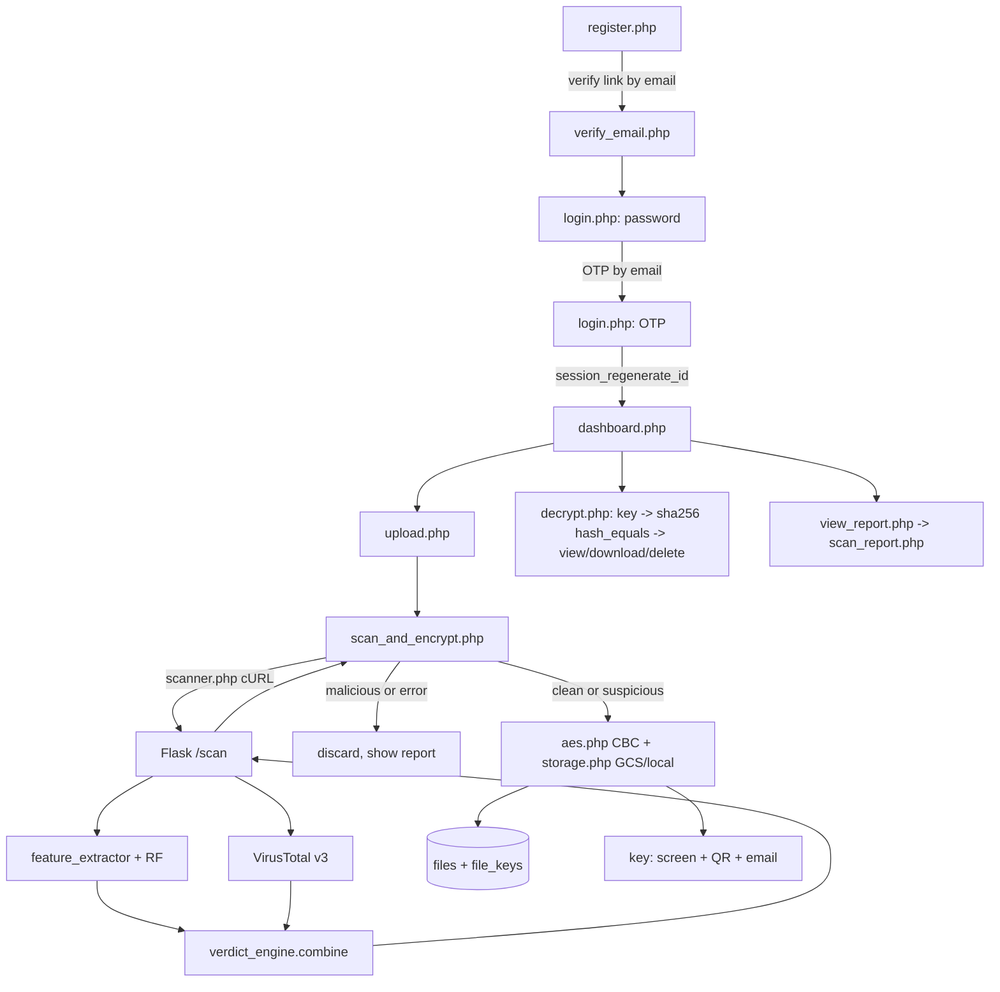

# Cloudie — Full Analysis & Hardening Audit (read-only phase)

Date: 2026-10-12 · Tree: `main` after PR #1 (branch `docs/audit-cloudie`) · Auditor: Claude Code
Scope: all code in `C:\xampp\htdocs\cloudie\` (excl. `.venv`, PHPMailer internals, `jsQR.js`). Nothing modified except this file. No GCP/DB access. No secret values printed.
Companions: `STUDY_GUIDE.md` (full flows and file:line), `AUDIT_CLOUDIE.md` (earlier, BM, 28 findings), `DEFENSE_QA.md`.

**Ground-truth corrections (code overrides the brief):** `files.verdict` is VARCHAR(**20**) (`includes/db.php:69`); validated accuracy is **99.87%** (stratified 75/25) and **99.46%** (size hold-out, recall 96.14%), not 99.80/99.53 (`flask_api/validation_report*.json`); VT HTTP 409 is **not handled anywhere** in code; `vt_client.py` is **not used** by `app.py`.

---

## 0. Status on 2026-10-28

This report is the 2026-10-12 read-only audit and is kept as it was written. Since then most findings were fixed.
Status re-checked in the code on 2026-10-28:

| Status | Findings |
|---|---|
| **Fixed** | A-01 (VT hash lookup + polling + 409 via `vt_client.scan_file`), A-02 (no QR fallback), A-03 (Flask private, Cloud Run IAM), A-04 (PDF magic-byte gate), A-05 (OTP fails closed), A-07 (rate limiting, `includes/ratelimit.php`), A-08 (SMTP timeout 10 s), A-14 (25 MB everywhere), A-15 (no VT result = ERROR, blocked), A-16 (report UI), A-29 (real credit links) |
| **Mostly / partly fixed** | A-09 (post-decrypt SHA-256 check, `verify_plaintext_integrity()`; CBC still has no MAC), A-10 (magic-byte check on upload, deny-all `.htaccess` in `uploads/`; still under the web root), A-11 (Secure cookie, HSTS, X-Frame-Options, Referrer-Policy, Permissions-Policy, POST logout; **no CSP**), A-19 (README and 256 tests; requirements still unpinned), A-26 (one stale "second opinion" comment left in `app.py`), A-27 (integrity uses SHA-256; the `file_md5` column remains) |
| **Open** | A-12 (verification fail-open, kept for the demo), A-13 (by design: not end-to-end), A-17 (metadata_size skew, `docs/METADATA_SIZE_INVESTIGATION.md`), A-18 (original training script), A-21, A-22, A-23, A-24, A-25, A-28 (message is generic but still says the name or email exists), A-30 (two old IPs) |
| Thesis only | A-06, A-20 (the thesis is no longer a deliverable) |

Added after this audit: sealed audit trail (HMAC hash chain), evasion layer for PDFs, structure layer for Office/ZIP/CSV/images/file
names, explainable AI score, AI familiarity, 2-engine block rule, and a false-positive benchmark on 200 real PDFs
(`docs/BENIGN_FP_BENCHMARK.md`: 1.0% tagged, 0 blocked).
Open questions answered: 1 (`VT_API_KEY` attached, 2026-10-20), 2 (the 503 was GCP billing), 3 (min instances 1 on both services
until the competition), 8 (decided: no VT result means blocked).

---

## 1. Executive summary

**Health score: 6.5 / 10.** Solid fundamentals (prepared statements everywhere, CSRF on all POSTs, bcrypt, hashed OTP, ownership checks on every query, CSPRNG keys, cleartext deleted after encryption) but the detection pipeline has one likely-broken link (VT read once) and several security claims in the thesis/UI are stronger than the code.

- **VT result may be unverified:** `app.py:197-228` reads the VT analysis once without polling; a *queued* analysis reads as zero detections (read from code, **not proven live**).
- **AES key leaks to a third party** via the QR fallback `api.qrserver.com/...?data=<key>` (`includes/qr.php:35-38`); `composer.json` has no QR library, so the fallback always runs.
- **Flask `/scan` is public** (deployed `--allow-unauthenticated`, no shared secret, `app.py:254`).
- **The AI runs on every file type** (`app.py:265`); a PNG scored P = 0.84 (measured), so ordinary non-PDF uploads become *suspicious*.
- **Two fail-open paths:** OTP shown on screen when email fails (`login.php:206`); registration auto-verifies when email fails (`register.php:65-72`). Also VT outage degrades to AI-only "clean" (`verdict_engine.py:109-112`).
- **Thesis claims a "recovery PIN"** that does not exist; ERD, Table 4.3 and several "in parallel"/"only clean stored" statements differ from the code (section 5).
- **No tests, no README, unpinned requirements, no brute-force limits, SMTP timeout of 300 s inside request paths.**
- Positives: no hardcoded secrets in code or git history (scanned, masked), no `debug=True`, no `var_dump`/debug leftovers, IDOR-safe queries, blobs go to GCS on Cloud Run, rollback + blob cleanup on failed upload.

---

## 2. Architecture map

```
cloudie/
├─ index.php login.php register.php verify_email.php logout.php
├─ dashboard.php upload.php scan_and_encrypt.php decrypt.php
├─ folder.php create_folder.php profile.php view_report.php
├─ includes/  config db auth aes storage scanner mailer qr scan_report header footer auth_ui  (+PHPMailer/src)
├─ flask_api/ app.py feature_extractor.py verdict_engine.py prediction_log.py vt_client.py(unused)
│             malware_rf.pkl malware_rf.metrics.json validate_model.py Final.csv Dockerfile
├─ database/cloudie_schema.sql   ml/train_model.py(old)   docs/   Dockerfile composer.json
```



---

## 3. Known-issues status

| Issue | Status | Evidence |
|---|---|---|
| "33" instead of "32" | **Fixed** in code; **Partial** elsewhere | No "33 feature(s)" in any `*.php/*.py` (grep). `register.php:105`, `index.php:60,126` = 32. Still: `ml/train_model.py:6,37-44` (old 33-col design) and `flask_api/figures/*.png` (old run) |
| Accuracy tile placeholder | **Fixed** | `index.php:171-172` → 99.87% / "size-based: 99.46%" |
| Placeholder portfolio links | **Still present** | `index.php:271` `github.com/your-username`, `:275` `linkedin.com/in/your-handle`, `:279` `you@example.com` |
| PDO named-placeholder reuse | **Fixed** | All queries positional `?`; no `:name` placeholders in app PHP; `login.php:175-182` |
| Flask four-file consistency | **Fixed / consistent** | pkl `n_features_in_`=32, `features` list equals `FEATURE_NAMES` (checked at `app.py:99-119`; measured identical); metrics top-10 equals pkl importances; `metrics.json` has no `feature_count` key (only `/health` reports it) |

---

## 4. Findings

Severity is for a student FYP demo that must survive an examiner, not a bank. IDs are new in this report (cross-ref to `AUDIT_CLOUDIE.md` F-numbers in the last column of the note).

| ID | Sev | Category | File:line | Problem | Why it matters | Recommended fix | Effort | Thesis impact |
|---|---|---|---|---|---|---|---|---|
| A-01 | **Critical** | Verdict/VT | `flask_api/app.py:197-228`; `vt_client.py:137-178` unused | VT: `POST /files`, then one `GET /analyses/{id}`, no polling, no hash lookup. A queued analysis has zero stats → `positives=0,total=0` treated as "VT available, clean". No 409/429 handling: any non-200/201 → "no result" (`:204-206`) | The primary detector can silently pass malware; breaks the VT-primary claim | Replace `vt_scan` with `vt_client.scan_file` (hash-first, poll ≤ 60 s); treat `queued`/`total==0` as "no result"; handle 429/409 explicitly. Verify with EICAR | M | **Yes**: Table 4.6 / Bab 4.4.7 |
| A-02 | **High** | Crypto/Privacy | `includes/qr.php:22,35-38`; `composer.json:4-6`; `scan_and_encrypt.php:244,319` | QR fallback puts the 64-hex AES key in a URL fetched by the browser from api.qrserver.com; code comment says it never leaves the machine | Key exposure to a third party; contradicts "you hold the key" | `composer require endroid/qr-code` or render QR client-side (JS); fix comment | S | **Yes** (key custody claim) |
| A-03 | **High** | Flask/Access | `flask_api/app.py:254-258`; `docs/DEPLOY_NOTES.txt:54` | `/scan` has no auth; Cloud Run deployed `--allow-unauthenticated`. `/health` leaks metrics | Anyone can burn VT quota/CPU, probe the model | Cloud Run IAM (invoker = php service account + ID token) or shared-secret header checked in Flask | M | No |
| A-04 | **High** | Verdict/ML | `app.py:265-277`; `config.php:77-78`; `feature_extractor.py:123-165` | Any of 14 extensions is saved as `.pdf` and scored. PNG → 0.84. VT-clean PNG/DOCX/ZIP → *suspicious* | Looks like a bug in the live demo; AI label meaningless for non-PDF | Gate: if first 1 KB lacks `%PDF-` skip RF (verdict from VT only); say so in UI/thesis | S | **Yes** (5.3 limitation vs behaviour) |
| A-05 | **High** | Auth | `login.php:137,206,266-272` | If OTP email fails, code is rendered on the page → password alone suffices | 2FA silently off during SMTP outage | Show only when `MAIL_ENABLED=false` **and** a dev flag; otherwise fail closed with retry | S | Minor |
| A-06 | **High** | Thesis | Thesis 4.2, 4.5, 5.1, 5.5 | "Email recovery PIN … hashed, time-limited, single-use" described; no forgot/reset feature in code (grep) | Examiner asks for demo | Remove claims (or build reset) | S | **Yes** |
| A-07 | **High** | Auth | `login.php:171-211,116-139`; `register.php` | No throttling/lockout on password attempts, register or upload; OTP resend resets `otp_attempts` (`:38-44`) | Password guessing; 5 OTP tries per 60 s | Per-account+IP counter (table or cache), lockout/backoff, don't reset attempts on resend | M | No |
| A-08 | Medium | Reliability | `includes/mailer.php:41-61`; PHPMailer `Timeout=300` (`PHPMailer.php:380`) | Mail is sent synchronously in register/login/upload requests with the library default 300 s timeout. "Non-blocking" is only about errors, not latency | SMTP stall hangs the upload/login page up to 5 min (Cloud Run request limit) | `$m->Timeout = 10;` (and `SMTPKeepAlive` off) | S | Wording "non-blocking" |
| A-09 | Medium | Crypto | `decrypt.php:61-71`; `scan_and_encrypt.php:76,209` | `file_md5` stored but never re-checked after decrypt; CBC has no MAC. Key-hash check proves key possession only | "Hash-based integrity verification" is not implemented in the app | After decrypt compare `md5/sha256($plain)` with stored value (S); GCM later (M-L) | S | **Yes** (Table 4.5 = manual test) |
| A-10 | Medium | Upload | `scan_and_encrypt.php:47-58`; `config.php:64,77` | Extension-only check (no magic bytes/MIME); cleartext temp file in web-root `uploads/` with no deny rule, time-based name | Mislabelled files accepted; brief cleartext exposure | `finfo_file` per type; `uploads/.htaccess Require all denied` or temp dir outside docroot | S | No |
| A-11 | Medium | Sessions/Headers | `config.php:88-97`; only `nosniff` at `decrypt.php:86` | No `Secure` cookie flag, no CSP/X-Frame-Options/HSTS/Referrer-Policy, logout via GET, no idle timeout | Clickjacking/cookie hygiene; easy for examiner to check headers | Set `secure=>true` on HTTPS, send 3-4 security headers in `config.php`, POST logout | S | No |
| A-12 | Medium | Auth | `register.php:65-72`; `profile.php:81-87` | Verification/email-change fail-open when mail fails | Unverified addresses become verified | Same dev-flag pattern as A-05 | S | No |
| A-13 | Medium | Privacy | `app.py:197-203`; `scan_and_encrypt.php:248-254` | Cleartext file uploaded to VirusTotal (shared with VT community); key emailed in clear | "Confidential storage"/"key only with you" overstated | Hash lookup first; consent text; state limits in thesis | M | **Yes** (wording) |
| A-14 | Medium | Reliability | `config.php:74` vs `app.py:52`; `vt_client.py:140` | Limits disagree: PHP 50 MB, Flask 25 MB, VT free 32 MB | 25–50 MB uploads fail with generic "scan failed" (413 not JSON) | Single limit 25 MB in PHP, UI text, thesis | S | Minor |
| A-15 | Medium | Verdict | `verdict_engine.py:99-125` | VT down/no key → AI-only: AI<0.5 stored as **clean**; also `vt_scan` swallows all errors | Fail-open on the primary detector | Option: when VT configured but unavailable, tag *suspicious* ("unverified") instead of *clean* | S | **Yes** (say so in Q&A) |
| A-16 | Medium | UI bug | `view_report.php:74`; `scan_report.php:91-93,338` | `is_clean != 1` rendered as "File rejected" → stored *suspicious* files look rejected | Inconsistent with dashboard/upload result | `$rejected=false` for stored files; show `verdict` | S | Minor |
| A-17 | Medium | ML | `feature_extractor.py:142-143,66-88`; `Final.csv` | Train/serve skew: `metadata_size`=0 without XMP (never 0 in training; top feature 19.6%); substring counts (`obj` counts `endobj`: 962 vs 481 measured); benign PDFs score 0.28–0.41 | Explains uncertainty outside dataset; Q&A risk | Document; long-term retrain with own extractor | L | **Yes** (explain) |
| A-18 | Medium | Repro | `ml/train_model.py:6,37-44` | Script that produced the deployed pkl is not in repo | "Can you reproduce your model?" | Add actual training script + seed | M | **Yes** |
| A-19 | Medium | Quality | repo root | No tests, no README; `flask_api/requirements.txt` unpinned (`scikit-learn>=1.3.0`) with a pickled model | Version drift can break model load; no regression safety | Pin versions used for training; add README + 3 tests (section 7) | M | No |
| A-20 | Medium | Thesis | see section 5 | Table 4.3, ERD, "in parallel", "only clean stored", key-storage wording | Direct contradictions | Edit thesis | M | **Yes** |
| A-21 | Medium | Schema | `database/cloudie_schema.sql:35-48` | `authentication.user_id` is not `UNIQUE` (thesis says 1:1) | Duplicate auth rows possible; login code reads `LIMIT 1` | `ALTER … ADD UNIQUE (user_id)` | S | ERD |
| A-22 | Low | Reliability | `decrypt.php:92-94` | Delete removes blob first, then DB row; if DB delete fails the row points to a missing blob. (Upload path is correct: rollback + `storage_delete_encrypted`, `scan_and_encrypt.php:232-238`) | Minor orphan | Delete DB row first, then blob (best effort) | S | No |
| A-23 | Low | Config | `config.php:111-112` | `display_errors` defaults to ON; prod relies on env `DISPLAY_ERRORS=0` (set in `DEPLOY_NOTES.txt:24`) | Leak if env missing on a fresh deploy | Default `'0'` | S | No |
| A-24 | Low | Docker | `Dockerfile`, `flask_api/Dockerfile` | Both run as root, no `HEALTHCHECK`/`USER`; Flask requirements unpinned; `Final.csv` excluded only by `.gcloudignore` | Hardening hygiene | `USER www-data`/non-root, pin deps | S | No |
| A-25 | Low | Observability | `app.py:44-46`; `prediction_log.py` | CSV log on ephemeral disk (lost); mixed `logging` and `print` | Thesis 4.4.7 cites CSV as evidence | Use DB `actions`/`files.scan_report` as evidence; log JSON to stdout | S | **Yes** (field list mismatch) |
| A-26 | Low | Code quality | `app.py:184,276,279,311-314`; `vt_client.py:17-19` | Stale comments say AI-primary / "anything else is blocked" | Examiner reading code | Fix comments; use or delete `vt_client.py` | S | Minor |
| A-27 | Low | Hash | `app.py:348`; `files.file_md5` | MD5 used for file identity | Collision-weak, but not a security boundary | Store SHA-256 (already computed, `:349`) | S | Wording "MD5" in thesis tests |
| A-28 | Low | Privacy | `register.php:76-77` | Username/email enumeration at registration | Minor | Generic message | S | No |
| A-29 | Low | Placeholder | `index.php:271,275,279` | Placeholder links | Unprofessional | Real URLs | S | No |
| A-30 | Low | Infra (manual) | CLAUDE.md | Cloud SQL public IP + authorized networks | Attack surface | Cloud SQL connector/private IP; remove stale IPs | M | No |

Checked and **not** findings: SQL injection (all prepared; only interpolated value is `(int)OTP_TTL_MINUTES`, `login.php:41`), XSS (all dynamic output through `e()`/casts; HTML/SVG not allowed as uploads), CSRF on every POST handler, IDOR (every file/key/folder/report query has `AND user_id = ?`: `decrypt.php:37`, `view_report.php:34`, `folder.php:10-33`), `random_bytes`/`random_int` for keys, IV, OTP and tokens, `hash_equals` for key/CSRF/verify token, bcrypt, `session_regenerate_id` at login and password change, `debug=False`, no secrets in code/git history, fixed MIME map + `nosniff` on downloads, cleartext deleted on every exit path, atomic DB transaction with blob cleanup. IV is unique per file (fresh `random_bytes(16)`), PKCS#7 padding handled by OpenSSL, wrong-key/padding errors return a generic message.

---

## 5. Thesis–code mismatches

Thesis file: `docs/thesis-and-presentation/FYP_THESIS_formatted.docx`. Already consistent: 32 features, dataset size/split (3,626 test rows), VT-primary wording in most places, three verdicts, AES-256-CBC, SHA-256 key hash (Physical Design paragraph).

| # | Thesis location | Thesis says | Code location | Code says |
|---|---|---|---|---|
| 1 | 4.2, 4.5, 5.1, 5.2, 5.5 | Recovery PIN by email | whole repo | No recovery feature; OTP is login 2FA (`login.php:36-47`) |
| 2 | 3.3.6 ERD (KEY, FILE) | KEY `key_content`; FILE has `key_id` | `schema.sql:90-101` | `file_keys(key_hash, iv_b64, created_at)`; link is `file_keys.file_id` |
| 3 | 3.3.6 FILE | verdict `Varchar(16)`, scan_report JSON, few columns | `db.php:69`; `schema.sql:67-84` | VARCHAR(20), TEXT, plus `stored_name,file_size,is_clean,folder_id,uploaded_at` |
| 4 | 3.3.6 AUTHENTICATION, ACTION; no FOLDER | 4 / 5 columns | `schema.sql:35-62,106-120` | + `email_verified, verify_token, otp_*, last_login`; `details, act_time`; `folders` table |
| 5 | 3.3.3, 3.3.4, 3.3.5, 3.4, 4.3.7, 4.4.7 | VT and AI "in parallel" | `app.py:271-283` | Sequential in one request |
| 6 | 3.3.3, 3.3.4 | VT returns malicious/clean/suspicious | `app.py:226`; `verdict_engine.py:32` | ≥ 1 flagging engine (malicious+suspicious) = malicious; no VT-suspicious in live path |
| 7 | 4.2 first paragraph | Reversed sentence on suspicious/safe | `verdict_engine.py:99-106` | Suspicious = VT clean + AI malicious |
| 8 | 4.4.7, 5.1 | Only agreeing/clean files stored | `scan_and_encrypt.php:171-172` | clean **and** suspicious stored |
| 9 | 4.1 Table 4.1 test 5; 4.3.7 | AI detection rejects malicious file | `verdict_engine.py:91-94` | Only VT can block; AI alone → suspicious |
| 10 | 4.4.3 Table 4.3 | 99.53% / recall 97.00% | `validation_report_size_holdout.json:59-78` | 99.46% / 96.14%; 99.87% stratified re-run |
| 11 | 4.4.3 | Presents hold-out as testing the model | `validate_model.py:223` | Re-trains the pipeline; pkl not tested |
| 12 | 4.3.8, 4.4.5 | "encryption key stored in file_keys" | `scan_and_encrypt.php:218-226` | Only `sha256(key)` + IV |
| 13 | 3.3.4, 3.3.5 | User inputs/provides the key at encryption | `scan_and_encrypt.php:177` | System generates it |
| 14 | Table 3.9 tests 3, 9 | "authorized by admin"; "Generate Key" button | repo | No admin role, no button |
| 15 | 3.3.5 | Malware alerts by email or text | repo | On-screen report only |
| 16 | 3.3.5 Fig 3.7; 3.3.1; 4.3.7 vs 5.3 | File-type check; "different file types"; PDF only | `scan_and_encrypt.php:48-52` | Extension allow-list; RF on all 14 types |
| 17 | 4.4.7 | CSV log has file hash, type, timestamp | `prediction_log.py:21-34` | Different fields; ephemeral on Cloud Run |
| 18 | 4.4.4–4.4.6 Tables 4.4, 4.5 | AES timings; hash match | repo | No benchmark script; no post-decrypt hash check in app |
| 19 | 4.5 | No harmful content can penetrate | A-01, A-04, A-15 | Not guaranteed |
| 20 | 4.3.4 / 4.3.7 | Wrong figure captions, duplicate 4.3.7 and Figure 4.9 | — | Editorial |

Code-side (internal notes): `CLAUDE.md` says "VT 409 non-critical" and "`vt_client.py` … combines them"; neither is true in code.

---

## 6. Defense risk notes

| Examiner pokes at | Risk | One-line verbal answer |
|---|---|---|
| "Why VT primary when you built AI?" | Low | "VT has 70+ updated engines; my model is validated on one dataset and is uncertain outside it (real PDFs score 0.3–0.4), so it can flag but not block." |
| "Is 99.87% your deployed model?" | Medium | "No: it re-trains the same pipeline on a held-out split; the pkl's own test is 99.86%, and recall on the harder size split is 96.14%." |
| "What if VT is down?" | **High** | "It degrades to AI-only: AI-clean files are stored, AI-flagged are tagged suspicious; both down → blocked. A stricter policy would tag unverified as suspicious." |
| "Can the admin read my files?" | Medium | "Not from DB+bucket (keys not stored), but I don't claim zero-knowledge: the key passes through server memory and email." |
| "Why CBC?" | Medium | "Scope decision; CBC lacks integrity, GCM is future work; today only key possession is checked." |
| "Upload a PNG / EICAR live" | **High** | Rehearse: PNG shows *suspicious* (A-04); EICAR must show *malicious* (A-01). Fix first. |
| "Call your Flask URL directly" | **High** | "It is public in the prototype; IAM or shared secret is the fix." |
| "Show recovery PIN" | **High** | Remove from thesis before defense. |
| "Check HTTP headers / cookie flags" | Medium | "Basic hardening is future work; HttpOnly and SameSite are set." |
| "Contagio overlap?" | Medium | "Yes, partly; I did not test on Contagio; independent dataset is future work." |

---

## 7. Roadmap

**Test plan (minimal):** (1) `feature_extractor` on a tiny JS+OpenAction PDF → 32-vector, `header` 1.3; (2) `verdict_engine.combine` over the 7 decision rows incl. both-unavailable → `error`; (3) AES round-trip and wrong-key → null; (4) integration: upload clean PDF → `files`+`file_keys` rows; malicious (mock VT) → nothing stored; other user's `file_id` → "not found".

**Phase 1 — must-fix before defense (low risk):**
A-01 (VT polling + EICAR), A-04 (PDF gate), A-02 (QR), A-06 + A-20 (thesis edits, section 5), A-05, A-09 (post-decrypt hash), A-16, A-14, A-29, A-26, A-23. Note: A-01 and A-04 touch Flask only; neither changes the VT-primary/RF-secondary design nor the 32-feature contract.

**Phase 2 — should-fix:**
A-03 (Flask auth), A-07 (rate limiting), A-08 (SMTP timeout), A-10, A-11, A-12, A-15, A-18, A-19 (tests, README, pins), A-21, A-22, A-24, A-25, A-27.

**Phase 3 — future work (Bab 5):**
A-13 privacy/zero-knowledge (client-side encryption), AES-GCM or encrypt-then-MAC (new nonce/tag column, re-encrypt old blobs), A-17 retrain with own extractor + independent PDF test set, A-28, A-30 (private IP), password reset/key escrow, admin and audit views.

---

## 8. Open questions

1. Is `VT_API_KEY` actually attached to `cloudie-flask`, and what did the live VT calls return (queued vs completed)? (CLAUDE.md TODO 3)
2. Cause of the HTTP 503 on 2026-10-12 (billing, revision, Cloud SQL stopped)?
3. Which Cloud Run settings are live: min instances, timeout, memory, ingress, service accounts and roles?
4. Is the GCS bucket "public access prevention" on, and what IAM does it have?
5. Which script/commit trained the deployed `malware_rf.pkl`, and with which scikit-learn version?
6. Is the GitHub repo private (it contains vulnerability notes and resource names)?
7. Did the thesis tests (Tables 4.4–4.6) have recorded evidence (screenshots/scripts)?
8. Should unverified (VT unavailable) files be *clean* (current) or *suspicious*? Policy decision for the supervisor.
