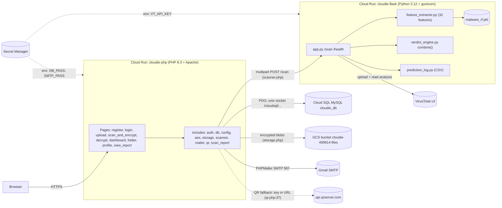
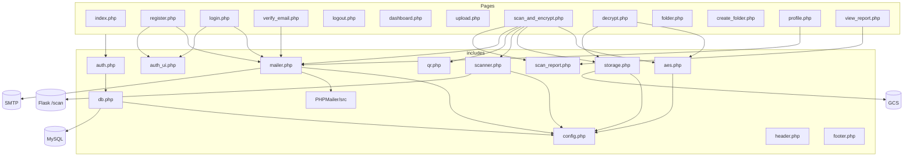

# Cloudie — Study Guide for the Defense

Prepared 2026-10-12 from a read-only pass over `C:\xampp\htdocs\cloudie\` (code wins over notes).
Every `file:line` below was read in the current tree. Where a claim is **measured** (I ran it) or **read from code only**, it says so.
Nothing was deployed, edited or committed. No secrets are printed.

> Convention: `app.py:271` = `flask_api\app.py` line 271. PHP files without a folder are in the project root.

---

## 1. Cloudie in 5 sentences

1. Cloudie is a web vault where every uploaded file is scanned for malware **before** it is encrypted and stored.
2. The scan runs in a Flask API: **VirusTotal is the primary detector** (a hit blocks the file), and a **32-feature Random Forest** looks at PDF structure as a supporting signal (it can only downgrade a file to *suspicious*, never block it alone).
3. Files that are not blocked are encrypted with **AES-256-CBC** using a random per-file key and IV; the server keeps only `sha256(key)` and the IV, and the user gets the key once (screen, QR, email).
4. Login is password + emailed 6-digit OTP, and accounts must verify their email first.
5. It runs on Google Cloud (two Cloud Run services, Cloud SQL MySQL, a Cloud Storage bucket, Secret Manager) and also runs locally on XAMPP.

---

## 2. Architecture and codebase map

### 2.1 Architecture diagram



Local XAMPP is the same code with: `127.0.0.1` MySQL, `encrypted/` folder instead of GCS (`config.php:38-41`, `storage.php:56-60`), `MAIL_ENABLED=false` (OTP shown on screen), Flask on `127.0.0.1:5000`.

### 2.2 Include / dependency picture



### 2.3 File-by-file map (excluding `.venv`, `vendor`, `encrypted`, `uploads`, `keys`, `.git`, `docs`)

**Root PHP pages**

| File | What it does | Calls / includes |
|---|---|---|
| `index.php` | Public landing page (pitch, stats tile 99.87% / 99.46%, placeholder social links at ~L271-279) | `auth.php`, `header.php`, `footer.php` |
| `register.php` | Sign-up form + handler, sends verification mail | `auth.php`, `mailer.php`, `header.php`, `auth_ui.php` |
| `login.php` | Two-stage login (password, then OTP), resend OTP, resend verification | `auth.php`, `mailer.php`, `header.php`, `auth_ui.php` |
| `verify_email.php` | Consumes `?uid=&token=` link, marks verified, sends welcome mail | `auth.php`, `mailer.php` |
| `logout.php` | Logs `LOGOUT`, destroys session | `auth.php` |
| `dashboard.php` | Lists user's files + counts (total / clean / suspicious / bytes) | `auth.php`, `header.php` |
| `upload.php` | Upload form (drag-drop, progress overlay), posts to `scan_and_encrypt.php` | `auth.php`, `header.php` |
| `scan_and_encrypt.php` | **Core pipeline**: validate, scan, verdict, encrypt, store, show key | `auth, db, aes, storage, scanner, qr, mailer, header, scan_report` |
| `decrypt.php` | Key form + view / download / delete after key check | `auth, db, aes, storage, header` |
| `folder.php` | One folder: list files, add/remove files, rename, delete folder | `auth.php`, `header.php` |
| `create_folder.php` | POST-only: creates a folder, redirects to it | `auth.php` |
| `profile.php` | Edit username/email/phone (needs password), change password | `auth.php`, `mailer.php`, `header.php` |
| `view_report.php` | Shows stored `files.scan_report` JSON, `?dl=json|txt` downloads (no key needed) | `auth, db, header, scan_report` |

**`includes\`**

| File | What it does | Calls / includes |
|---|---|---|
| `config.php` | Constants from env vars with local fallbacks; **starts the session**; creates local dirs; sets `display_errors` | none |
| `db.php` | `db()` PDO singleton (socket or TCP), `db_ensure_folders()`, `db_ensure_auth()`, `log_action()` | `config.php` |
| `auth.php` | `current_user()`, `require_login()`, flash, `csrf_token()/verify_csrf()`, `e()`, `app_url()` | `db.php` |
| `aes.php` | Key/IV generation, encrypt/decrypt (file and in-memory), `hash_aes_key()`, hex helpers | `config.php` |
| `storage.php` | `storage_put/get/delete_encrypted()`; local disk or GCS | `config.php`, Composer autoload (GCS SDK) |
| `scanner.php` | `scan_file_with_ai()` cURL multipart POST to Flask; `scanner_health()` | `config.php` |
| `mailer.php` | PHPMailer wrappers: key, OTP, verification, welcome emails | `config.php`, `PHPMailer/src/*` |
| `qr.php` | `qr_image_src()`: endroid if installed, else `api.qrserver.com` URL | none |
| `scan_report.php` | Partial that renders the AI + VT report card (shared by upload-rejected and view_report) | none (uses `e()`) |
| `header.php` / `footer.php` / `auth_ui.php` | Theme, sidebar/topbar shell; closing tags; password-toggle JS | `current_user()` |
| `PHPMailer/src/*` | Vendored PHPMailer 6.9.1 | — |

**`flask_api\`**

| File | What it does | Calls / includes |
|---|---|---|
| `app.py` | Flask app: `/health`, `/scan` = `/analyze`; model load; `ai_predict()`; its **own** `vt_scan()`; builds the JSON | `feature_extractor`, `verdict_engine`, `prediction_log`, `malware_rf.pkl`, VirusTotal HTTP |
| `feature_extractor.py` | Builds the 32-feature dict/vector from raw PDF bytes (regex + `bytes.count`) | stdlib only |
| `verdict_engine.py` | `combine()`: VT-primary decision table, AI confidence | none |
| `vt_client.py` | A richer VT client (hash lookup + polling). **Not imported by anything** (dead code) | `requests` |
| `prediction_log.py` | Appends one CSV row per scan | stdlib |
| `malware_rf.pkl` / `malware_rf.metrics.json` | Model bundle `{"model","features"}` and its own 80/20 metrics | — |
| `validate_model.py` | Re-trains the same config on two hold-out designs and reports metrics | `Final.csv`, sklearn |
| `validation_*.json/.csv`, `figures/*.png` | Output of the validation run (PNG figures are the **old** run) | — |
| `Final.csv` | CIC-Evasive-PDFMal2022, 18,126 rows × 34 columns (`name`, 32 features, `class`) | — |
| `requirements.txt`, `Dockerfile`, `.dockerignore`, `.gcloudignore` | Build/deploy (gunicorn 1 worker × 8 threads, timeout 120 s) | — |

**Other**

| File | What it does |
|---|---|
| `Dockerfile` (root) | php:8.3-apache, `pdo_mysql zip gd`, Composer, prod `php.ini` + 60M upload / 256M memory, Cloud SQL socket path, `$PORT` rewrite |
| `composer.json` | Only `google/cloud-storage` (so **no** endroid QR library) |
| `database/cloudie_schema.sql` | Canonical schema, mirrors what `db.php` migrates |
| `ml/train_model.py` | **Old** 33-column training design; does *not* produce the deployed pkl (different column names). Reference only |
| `assets/css/style.css`, `assets/js/jsQR.js` | Styles; client-side QR decoder used by the decrypt page |
| `.gitignore`, `.gcloudignore`, `.dockerignore`, `CLAUDE.md` | Repo/deploy hygiene and project notes |

---

## 3. Request flows (step by step)

### 3.1 Register — `register.php`

1. `register.php:5` `db_ensure_auth()` adds auth columns if missing (see 3.8). `:7` logged-in users bounce to the dashboard.
2. POST → `:13` CSRF check (`auth.php:41`).
3. `:22-29` validation: required fields, `FILTER_VALIDATE_EMAIL`, password ≥ 8 chars, confirm matches.
4. `:33-44` transaction: insert `users` with `password_hash(..., PASSWORD_BCRYPT)` (`:40`); `username` and `email` are `UNIQUE` (schema).
5. `:46-51` insert `authentication` row with `email_verified = 0`, a random 32-byte hex `verify_token`, and a separate random `token`.
6. `:53-54` commit, log `REGISTER`.
7. `:60-61` build link `verify_email.php?uid=..&token=..` and call `send_verification_email()` (`mailer.php:218`).
8. If the mail was sent: flash "check your inbox" (`:62-64`). **If it failed** (mail disabled or SMTP down): `:66-71` the account is **auto-verified** and the welcome email is attempted (fail-open, see weakness W4).
9. Duplicate username/email → SQLSTATE `23000` → friendly error (`:76-77`).

### 3.2 Email verification, login, OTP

**Verify email** — `verify_email.php:22-47`: loads the auth row by `uid`; already verified → "already"; else `hash_equals(verify_token, token)` (constant time) → set `email_verified=1`, `verify_token=NULL` (single use), log `VERIFY_EMAIL`, send welcome mail.

**Login stage 1 (password)** — `login.php:171-211`:
1. Lookup by `username = ? OR email = ?` with two **positional** `?` (`:175-182`, the PDO gotcha).
2. `:185` `password_verify`. Old accounts with no `authentication` row get one (`:187-194`).
3. Unverified → error + "resend verification" button (`:196-198`).
4. Verified → `$_SESSION['otp_uid'] = uid` (**not yet logged in**, `:200`) and `otp_issue()`.

**OTP issue** — `login.php:36-47`: `random_int(0, 999999)` zero-padded to 6 digits (`:37`, CSPRNG); stored as `password_hash($code)` in `authentication.otp_hash` (**hashed**), `otp_expires = NOW() + 10 min`, `otp_attempts = 0` (`:38-44`); `otp_last_sent` stored in session; email sent. If mail fails, the code is returned and **displayed on the page** (`:206`).

**OTP verify** — `login.php:63-111`:
- No `otp_uid` in session → "session expired" (`:65-66`).
- Expired or missing hash → restart (`:79-81`). `otp_attempts >= 5` → restart (`:82-84`, constant `OTP_MAX_ATTEMPTS`).
- `password_verify($code, otp_hash)` → success (`:85`): clear OTP fields, set `last_login`, rotate `token` (`:86-91`), **`session_regenerate_id(true)` then `$_SESSION['user_id'] = $uid`** (`:93-94`) — this is where the session is created. Log `LOGIN`.
- Wrong code → `otp_attempts + 1`, shows attempts left (`:98-109`).

**Resend OTP** — `:116-139`: needs `otp_uid`; blocked if < 60 s since `otp_last_sent` (`:128`, `OTP_RESEND_SECONDS`); otherwise a new OTP is issued (which resets attempts to 0).

**Resend verification** — `:144-166`: always shows a neutral message (no account enumeration).

**Logout** — `logout.php`: log `LOGOUT`, clear `$_SESSION`, expire cookie, `session_destroy()`.

**Session settings** — `config.php:88-97`: cookie `httponly`, `samesite=Lax`, lifetime 0 (browser session). No `secure` flag (W9).

### 3.3 Upload → scan → encrypt → store (the core flow)

```mermaid
sequenceDiagram
  autonumber
  participant B as Browser
  participant S as scan_and_encrypt.php
  participant SC as includes/scanner.php
  participant F as Flask app.py /scan
  participant X as feature_extractor.py
  participant R as RandomForest (pkl)
  participant V as VirusTotal v3
  participant E as verdict_engine.combine()
  participant A as includes/aes.php
  participant ST as includes/storage.php
  participant D as MySQL
  participant M as mailer.php

  B->>S: POST file + csrf (multipart)
  S->>S: csrf, size <= 50 MB, extension allow-list
  S->>S: move_uploaded_file to uploads/up_*.ext (cleartext on disk)
  S->>SC: scan_file_with_ai(path, name)
  SC->>F: cURL POST /scan (60 s timeout)
  F->>X: extract_features(tmp .pdf)
  X-->>F: dict + 32-vector + extraction_ok
  F->>R: predict_proba(DataFrame by feature name)
  R-->>F: P(malicious)
  F->>V: POST /files then GET /analyses/id (once, no polling)
  V-->>F: stats or nothing
  F->>E: combine(ai_proba, vt_positives, vt_total, extraction_ok)
  E-->>F: verdict, confidence, rationale
  F-->>SC: JSON (verdict, features, ai, virustotal, combined ...)
  SC-->>S: ok/data or error
  alt verdict malicious or error
    S->>S: unlink temp file, render threat report / "could not verify"
    S-->>B: nothing stored, no key
  else clean or suspicious
    S->>A: random 32-byte key + 16-byte IV, AES-256-CBC encrypt (in memory)
    S->>ST: storage_put_encrypted(enc_xxx.bin) (GCS or encrypted/)
    S->>S: unlink cleartext
    S->>D: BEGIN; INSERT files; INSERT file_keys(sha256(key), iv); COMMIT
    S->>M: send_key_email (best effort)
    S-->>B: key (hex + QR + .txt) shown once
  end
```

Step by step with references:

1. **Form** — `upload.php:17-38` (POST + `csrf`); JS overlay `:100-175`. The page text at `:13-14` says "only files verified as clean are encrypted" — not exactly true, *suspicious* files are stored too.
2. **Validation** — `scan_and_encrypt.php:32-36` POST + CSRF; `:37-40` upload error; `:43-46` size in `(0, 50 MB]` (`config.php:74`); `:47-52` `basename`, lowercase extension in `ALLOWED_EXT` (14 types, `config.php:77-78`). The check is by **extension only** (no MIME/magic check).
3. **Temp file** — `:54-58` `UPLOAD_DIR . uniqid('up_', true) . '.' . $ext` (cleartext, inside the web root `uploads/`).
4. **Scan call** — `:63` → `scanner.php:13-52`: cURL multipart, timeout 60 s, connect 10 s; unreachable → `ok=false` (`:36-39`); invalid JSON or HTTP ≥ 400 → `ok=false`. On `ok=false`: `:64-68` delete temp, flash "Malware scan failed", back to upload.
5. **Flask `/scan`** (`app.py:254-440`):
   - `:265-268` saves to a temp file named `*.pdf` **whatever the real type**.
   - `:271` `extract_features()`; never raises (zero vector + `extraction_ok=False` on failure).
   - `:277` `ai_predict()` (`:141-180`): builds a one-row DataFrame in the model's own feature order, `predict_proba`, picks the class-1 column, label = `proba >= 0.5`.
   - `:280` `vt_scan()` (`:186-234`): if `VT_API_KEY` empty → `(None, None)`. Else `POST /files`, take the analysis id, **one** `GET /analyses/{id}` (no polling), `positives = malicious + suspicious`, `total = sum(stats)`. Any error → `(None, None)`.
   - `:283` `combine()` (see section 4.3).
   - `:291` `log_prediction()` to CSV.
   - `:402-433` returns flat keys PHP reads (`verdict`, `probability_malicious`, `file_md5`, ...) plus `ai`, `virustotal`, `combined`, the 32 `features`.
6. **Verdict handling in PHP** — `:72-75` normalises to one of `clean|suspicious|malicious|error`; `:78-80` logs `SCAN` with verdict and probability.

| Verdict | Condition (VT primary) | What PHP does | Stored? | Key shown? |
|---|---|---|---|---|
| **malicious** | VT ≥ 1 positive (any AI) | `:91-136` delete temp, render threat report (`scan_report.php`) with downloadable JSON, no DB rows | No | No |
| **error** | VT *and* AI both unavailable | `:138-168` delete temp, "File could not be verified" | No | No |
| **suspicious** | AI ≥ 0.5 and VT clean/none; or neither signal reliable | encrypt + store, `is_clean=0`, `verdict='suspicious'`, amber UI (`:263-274`, `:300-306`) | **Yes** | Yes |
| **clean** | VT clean/none and AI < 0.5 (and extraction ok) | encrypt + store, `is_clean=1`, `verdict='clean'` | **Yes** | Yes |
| scanner HTTP/timeout error | Flask down, bad JSON, HTTP ≥ 400 | `:64-68` flash error, nothing stored | No | No |

7. **Encrypt** — `:177-179` `generate_aes_key()` (32 bytes `random_bytes`), `generate_iv()` (16 bytes), blob name `enc_<uniqid>.bin`. `:184` `aes_encrypt_file_to_string()` reads the temp file and `openssl_encrypt(..., 'aes-256-cbc', OPENSSL_RAW_DATA, $iv)` (`aes.php:73-81`) — the whole file is in memory.
8. **Store** — `:190` `storage_put_encrypted()` (`storage.php:56-67`): local → `encrypted/enc_*.bin`; Cloud Run → `$bucket->upload($bytes, ['name' => $stored_name])`. Failure → delete temp, flash error. `:195` **`unlink($tmpPath)`** removes the cleartext.
9. **DB** — `:197-231` one transaction: `files` row (`file_name`, `stored_name`, `file_type`, `file_size`, `file_md5`, `is_clean`, `verdict`, `scan_report` JSON) then `file_keys` (`key_hash = sha256(rawKey)`, `iv_b64`). Commit, log `ENCRYPT`. On exception: rollback and `storage_delete_encrypted()` so no orphan blob (`:232-238`).
10. **Key delivery** — `:243-244` key as 64-hex, QR via `qr_image_src()`; `:248-254` `send_key_email()` (best effort, never blocks); page shows key box, copy button, `.txt` download as a `data:` URI, link to the report (`:309-331`). This is the only time the key is shown by design.

### 3.4 Decrypt / download / delete — `decrypt.php`

1. `:20` login required; `:23-29` action ∈ {view, download, delete}, `file_id > 0`.
2. `:32-44` join `files` + `file_keys` **filtered by `user_id = current user`** (ownership check). Not found → "File not found".
3. GET → render key form (`:105-320`): paste the 64-hex key, or scan the QR with camera / upload an image (client-side `jsQR.js`).
4. POST (`:52-100`): CSRF; `key_from_hex()` requires 64 hex chars (`aes.php:108-111`).
5. **`hash_equals($rec['key_hash'], hash_aes_key($rawKey))`** (`:61`): timing-safe comparison of `sha256(supplied key)` with the stored hash. Mismatch → error + log `DECRYPT_FAIL` (`:62-65`).
6. Match → `iv = base64_decode(iv_b64)` (`:67`), `storage_get_encrypted()` (GCS download or local file, `:68`), `aes_decrypt_string()` in memory (`:71`). Failure → "may be corrupted".
7. Log the action (`:75-76`). View/download: headers with MIME from a fixed map (`:325-343`), `Content-Disposition` inline/attachment, `X-Content-Type-Options: nosniff`, `echo $plain` (`:78-89`). The plaintext is never written to disk.
8. Delete: `storage_delete_encrypted()` then `DELETE FROM files WHERE file_id=?`; `file_keys` goes by `ON DELETE CASCADE`; `actions.file_id` becomes `NULL` (`:92-96`, schema). **Deleting needs the key too.**

> What the key check does and does not prove: it proves the user holds the right key. It does **not** verify the ciphertext was untouched, and `file_md5` is never recomputed after decryption (W11).

### 3.5 Dashboard, folders, profile, reports

| Page | Shows | Queries |
|---|---|---|
| `dashboard.php` | Summary cards (total, clean, suspicious, bytes) and file table with folder chips | `:8-15` `files LEFT JOIN folders WHERE f.user_id = ? ORDER BY uploaded_at DESC`; counts computed in PHP `:20-29`; verdict falls back to `is_clean` for old rows (`:25`, `:49-53`) |
| `folder.php` | One folder's files and an "add files" panel | `:10` folder owned by user; POST actions `add` (`:24`), `remove` (`:27`), `delete_folder` (`:30-33`, unassign files then delete), `rename` (`:36-42`); lists `:51-55` and `:59-63`. Every statement has `AND user_id = ?` |
| `create_folder.php` | Creates folder (name ≤ 100, color from a whitelist) | `:24` `INSERT INTO folders` then redirect |
| `profile.php` | Account details and password change | `:35` fetch hash; details need current password (`:53`); email change triggers re-verification when mail works (`:70-87`); password change needs current password, ≥ 8 chars, ≠ old, then `session_regenerate_id` (`:108-127`); logs `PROFILE_UPDATE` / `PASSWORD_CHANGE` |
| `view_report.php` | Stored scan report for a file the user owns; no key needed (the report is not secret) | `:30-36` `files WHERE file_id=? AND user_id=?`; `?dl=json|txt` (`:52-68`), logs `REPORT_DOWNLOAD`. Bug: `:74` treats `is_clean != 1` as "rejected", so a *suspicious* (stored) file renders as "File rejected" (W16) |

### 3.6 `db.php` auto-migrations

| Function | Adds | When it runs |
|---|---|---|
| `db_ensure_folders()` (`db.php:39-76`) | table `folders`; `files.folder_id` (+FK `ON DELETE SET NULL`); `files.verdict VARCHAR(20) NULL` | Called from `require_login()` (`auth.php:20`) on every logged-in request; `static $done` limits it to once per request |
| `db_ensure_auth()` (`db.php:83-105`) | `authentication.email_verified, verify_token, otp_hash, otp_expires, otp_attempts`; then `UPDATE ... SET email_verified = 1` for existing rows (grandfathering) | Called explicitly by `register.php`, `login.php`, `verify_email.php`, `profile.php` |

Both are idempotent: they attempt the `ALTER`, and ignore MySQL error **1060** (duplicate column). Cost: one failing `ALTER` per request. Anything else is only `error_log`ged. `database/cloudie_schema.sql` mirrors the final structure.

Tables (final): `users`, `authentication` (1:1), `folders`, `files` (`folder_id`, `verdict`, `scan_report`), `file_keys` (1:1 with files via `file_id UNIQUE`), `actions` (audit log).

Audit `act_type` values written by code: `REGISTER, VERIFY_EMAIL, LOGIN, LOGOUT, SCAN, ENCRYPT, DECRYPT_FAIL, VIEW, DOWNLOAD, DELETE, PROFILE_UPDATE, PASSWORD_CHANGE, REPORT_DOWNLOAD`.

---

## 4. The AI part

### 4.1 The 32 features

Order and names are fixed in `feature_extractor.py:27-60` and must equal the pickle's `features` list (checked at load by `app.py:111-119`; **measured**: identical, 32 names). "Dataset meaning" follows PDF-spec / PDFiD conventions used by CIC-Evasive-PDFMal2022; where I could confirm from `Final.csv` it says *(data)*.

| # | Feature | What `feature_extractor.py` computes | Dataset meaning |
|---|---|---|---|
| 1 | `pdf_size` | `len(blob)/1024`, KB (`:130`) | File size in KB *(data: benign median 75, malicious 9)* |
| 2 | `metadata_size` | length of the `<x:xmpmeta ...>` XMP block, **0 if absent** (`:142-143`) | Size of the document metadata *(data: never 0 in either class; median benign 319, malicious 180)*. **Largest importance (19.6%)** |
| 3 | `pages` | count of `/Type /Page` not followed by `s` (`:153`) | Number of pages |
| 4 | `xref_length` | chars between `xref` and `trailer` (`:156-157`) | Length of the cross-reference table |
| 5 | `title_characters` | length of the `/Title (...)` string (`:146-147`) | Characters in the title *(data: 0 in 85% of malicious vs 33% of benign)* |
| 6 | `isEncrypted` | 1 if `/Encrypt` appears (`:150`) | Document is encrypted |
| 7 | `embedded_files` | count of `/EmbeddedFile` (`:160`) | Embedded files |
| 8 | `images` | count of `/Subtype /Image` (`:161`) | Image objects |
| 9 | `contains_text` | **1 if `BT` appears, else 0** (`:165`) | Dataset has "Yes"/"No", trained as 1/0 *(data: 'No' for 92% of malicious)* |
| 10 | `header` | **PDF version as a float**: `%PDF-1.6` → 1.6, 0 if missing (`:135-139`) | The `%PDF-x.y` header, trained as the version number. Tree splits sit at 1.05-1.65 |
| 11 | `obj` | `count(b"obj")` (`:67`) | Number of `obj` keywords |
| 12 | `endobj` | `count(b"endobj")` | `endobj` keywords |
| 13 | `stream` | `count(b"stream")` | `stream` keywords |
| 14 | `endstream` | `count(b"endstream")` | `endstream` keywords |
| 15 | `xref` | `count(b"xref")` | `xref` keywords |
| 16 | `trailer` | `count(b"trailer")` | `trailer` keywords |
| 17 | `startxref` | `count(b"startxref")` | `startxref` keywords |
| 18 | `pageno` | `count(b"/Page")` | `/Page` objects |
| 19 | `encrypt` | `count(b"/Encrypt")` | `/Encrypt` count |
| 20 | `ObjStm` | `count(b"/ObjStm")` | Object streams (hide objects inside compressed streams) |
| 21 | `JS` | `count(b"/JS")` | `/JS` actions (embedded script) |
| 22 | `Javascript` | `count(b"/JavaScript")` | JavaScript actions. 96% of benign have 0 vs 14% of malicious *(data)* |
| 23 | `AA` | `count(b"/AA")` | Additional actions (event triggers) |
| 24 | `OpenAction` | `count(b"/OpenAction")` | Action run when the file opens |
| 25 | `Acroform` | `count(b"/AcroForm")` | Interactive forms |
| 26 | `JBIG2Decode` | `count(b"/JBIG2Decode")` | JBIG2 image filter (historic exploit target) |
| 27 | `RichMedia` | `count(b"/RichMedia")` | Embedded Flash/rich media |
| 28 | `launch` | `count(b"/Launch")` | Launch external program/file |
| 29 | `EmbeddedFile` | `count(b"/EmbeddedFile")` | Embedded file streams (same needle as #7) |
| 30 | `XFA` | `count(b"/XFA")` | XFA forms (XML, scriptable) |
| 31 | `URI` | `count(b"/URI")` | URI actions (links) |
| 32 | `Colors` | `count(b"/Colors")` | `/Colors` entries (DecodeParms) |

**Why `name` is not a feature.** `Final.csv` has 34 columns: `name` (file identifier such as `americans_elect`), the 32 features, and `class`. `name` is a label for the sample, not a property of the file. It is a string, would be perfectly memorisable, and cannot be computed for a new upload. Keeping it in the old validation run is what produced the "33 features" claim. The deployed model has `n_features_in_ = 32` (**measured**).

**Why `header` and `contains_text` need care.** In the CSV these are text ("%PDF-1.6", "Yes"/"No"). The model was trained on 1.6 and 1/0. The old extractor sent 1/0 for `header` and a count for `contains_text`, which put every real file in the wrong region of the trees. Fixed in the 2026-10-12 commit; `validate_model.py:82-100` applies the same encoding to the CSV.

**Known train/serve skews (new finding, measured on 2026-10-12)** — these matter when you explain "why do benign PDFs score ~0.4":
- `metadata_size` is **0** whenever a PDF has no XMP block (`feature_extractor.py:143`), but in the training data it is *never* 0 (0% of rows in both classes). It is the most important feature, and all three of my test PDFs got 0.
- `obj`, `stream`, `xref`, `pageno` use plain substring counts, so `obj` also counts `endobj`, `stream` also counts `endstream`, `xref` also counts `startxref`, `/Page` also counts `/Pages`. **Measured:** the poster PDF gives `obj=962` vs `endobj=481` (exactly 2×). In the dataset `obj == endobj` in 98.5% of rows and `stream == endstream` in 99.4%, so the dataset counted tokens, not substrings. (I re-computed with token-aware counts: P moved 0.28→0.38, 0.30→0.41, 0.41→0.46, i.e. this skew alone does **not** explain the 0.4, so do not claim it does.)
- `pdf_size`: training median 75 KB (benign); real documents here are 1-4.6 MB, outside most of the training range.
- The extractor runs on **every** allowed file type, not only PDFs (`app.py:265`). A PNG from `docs\figures` got P(malicious) = **0.84** (measured), so any non-PDF that VirusTotal passes would come out *suspicious*.

### 4.2 Model facts (measured from `malware_rf.pkl` in `.venv`)

| Item | Value | `malware_rf.metrics.json` agrees? |
|---|---|---|
| Container | dict `{"model", "features"}` | — |
| Class | `RandomForestClassifier` | — |
| `n_estimators` | **200** | (not recorded) |
| `criterion` | **gini** | (not recorded) |
| `class_weight` | **balanced** | (not recorded) |
| `max_depth` | None, `random_state` 42 | — |
| `n_features_in_` | **32** | yes (`/health` reports `model_expects`) |
| Classes | `[0, 1]` (1 = malicious) | yes |

Top-10 importances (pickle): `metadata_size` 0.1964, `Javascript` 0.1466, `JS` 0.1150, `pdf_size` 0.1047, `startxref` 0.0690, `endobj` 0.0596, `xref_length` 0.0578, `obj` 0.0351, `stream` 0.0343, `xref` 0.0235. This **matches** `feature_importance_top15` in the metrics JSON for these ten (same model, same order).

Model's own test (metrics JSON): stratified 80/20, n = 3,626, accuracy 99.862%, precision 100%, recall 99.724%, F1 99.862%, ROC-AUC 0.99968, confusion `[[1813,0],[5,1808]]`; 5-fold CV mean 99.81% (std 0.06%).

**Provenance gap:** the script that trained this pickle is **not in the repo** (`ml/train_model.py` is the old 33-column design with different column names). `validate_model.py:134-140` reproduces the *configuration* (200 trees, balanced, seed 42), not the exact artefact. Be ready to say so.

### 4.3 `verdict_engine.py` decision table

Constants: `PRIMARY_DETECTOR="VT"`, `AI_MALICIOUS_THRESHOLD=0.50`, `VT_MALICIOUS_MIN_HITS=1` (`:30-32`). `vt_positives = malicious + suspicious` engines (`app.py:226`), so **one engine is enough to block**.

| AI (P ≥ 0.5?) | VT | Verdict | Stored? | Code |
|---|---|---|---|---|
| any | ≥ 1 positive | **MALICIOUS**, confidence 0.95 | No | `:91-94` |
| malicious | clean | **SUSPICIOUS**, conf = max(ai_conf, 0.5) | Yes, tagged | `:99-106` |
| malicious | no result | **SUSPICIOUS** | Yes, tagged | `:102-104` |
| clean + extraction ok | clean or no result | **CLEAN**, conf = max(ai_conf, 0.6) | Yes | `:109-112` |
| AI unavailable / extraction failed | clean | **CLEAN**, 0.6 | Yes | `:121-125` |
| AI unavailable / extraction failed | no result | **SUSPICIOUS**, 0.4 | Yes, tagged | `:115-120` |
| unavailable | unavailable | **ERROR**, 0.0 | No (blocked) | `:80-83` |

AI confidence = `abs(p - 0.5) * 2` (`:77`): 0 at the fence, 1 at p = 0 or 1. It only feeds the `confidence` number in the report; the verdict itself depends on the 0.5 cut-off.

Two properties to remember: (1) the AI **alone can never block** a file; (2) with `VT_API_KEY` unset, "clean" simply means "AI < 0.5" (`:109-112`) — that is what happens on a local demo.

### 4.4 `validate_model.py` and the numbers

Two hold-out designs, both re-training a fresh RF with the production config on the training part and testing on the held-out part:

| Design | How | Result (seed 42, re-run 2026-10-12) |
|---|---|---|
| **Stratified random 75/25** (`:218-221`) | random split, class balance kept | accuracy **99.87%**, TN 2266, FP 0, FN 6, TP 2260, ROC-AUC 0.9997 |
| **Size-based hold-out** (`:205-214`, `--by pdf_size`) | test = top quartile of `pdf_size` (≥ 79 KB, n = 4,643); train on the other 13,483 | accuracy **99.46%**, FP 7, FN 18, precision 98.46%, **recall 96.14%**, ROC-AUC 0.9984 (`validation_report_size_holdout.json:59-78`) |

Why the size split is more conservative: the model never sees a file in the test size band during training, so it must extrapolate to larger files. In this dataset malicious files are small (median 9 KB vs 75 KB), so the held-out band is almost all benign (4,177 benign vs 466 malicious) and the few malicious ones are unlike the training malware. Accuracy is flattering there because of the class mix; **recall (96.14%) is the honest number**.

Why re-train instead of testing the deployed pickle: the pickle was trained on a random 80% of all rows (`metrics.json`: 3,626 test rows). A size-based test set would mostly overlap its training data, so the result would be inflated (leakage). Re-training on the complement is the only clean way to measure the size-based design. The honest statement is: these numbers validate the **training pipeline and configuration**; the pickle's own number is the 99.86% in `metrics.json`.

Caveat for "Isn't the dataset overlapping with Contagio?": `validate_model.py:22-28` says it plainly: CIC-Evasive-PDFMal2022 is built largely from Contagio + VirusTotal samples, so testing on raw Contagio would be circular. No independent external test set was used (`cross` mode exists but was not run).

### 4.5 Running the extractor on real PDFs (measured, 2026-10-12, `.venv` python)

| File | extraction | Non-zero features (abridged) | P(malicious) |
|---|---|---|---|
| `Project presentation poster.pdf` (1.0 MB) | ok | `pdf_size 1060, pages 2, images 24, contains_text 1, header 1.4, obj 962, endobj 481, stream 602, AA 3` | **0.28** |
| `FYP_THESIS_formatted.pdf` (4.6 MB) | ok | `pdf_size 4599, pages 112, images 52, header 1.7, obj 1774, URI 28` | **0.30** |
| `flow.pdf` (1.4 MB) | ok | `pdf_size 1356, pages 1, images 16, header 1.4, obj 1026, AA 3` | **0.41** |
| `figure_3_8_erd.png` (not a PDF!) | "ok" | `pdf_size 152, contains_text 1` (all else 0) | **0.84** |
| hand-made PDF with `/OpenAction` + `/JavaScript` (harmless `app.alert`) | ok | `JS 1, Javascript 1, OpenAction 1, header 1.3` | **0.91** |

Why benign real-world PDFs sit around 0.3-0.4 instead of ~0.05: they are **out of the training distribution** (large, image-heavy, modern 1.4-1.7 producers, no XMP so `metadata_size = 0`, plus the substring counting above). Random Forest probability is the share of the 200 trees voting "malicious"; for inputs far from the training data the trees disagree and the share drifts toward the middle. The verdict is still *clean* because < 0.5. This is a good argument for VT being primary: the structural model is strong in-distribution and uncertain outside it.

---

## 5. Security design

### 5.1 AES-256-CBC

- **Key**: `random_bytes(32)` per file (`aes.php:9-11`). **IV**: `random_bytes(16)` per file (`:13-15`). New pair for every upload (`scan_and_encrypt.php:177-178`).
- **Encrypt**: `openssl_encrypt($plain, 'aes-256-cbc', $key, OPENSSL_RAW_DATA, $iv)` (`aes.php:78`); PKCS#7 padding by OpenSSL.
- **Stored**: ciphertext in GCS/`encrypted/`; in `file_keys`: `key_hash = sha256(key)` (64 hex) and `iv_b64`. **Never stored**: the raw key. The IV is not secret.
- **Why `sha256(key)`**: it lets the server check "is this the right key?" without holding the key. The key is 256 bits of CSPRNG output, so a plain fast hash is not brute-forceable (unlike a password; no salt/slow hash needed). If the DB leaks, the attacker gets hashes of random 256-bit values: no path to the key, no path to the plaintext.
- **What the server does see**: the key transiently, in memory, at upload and whenever a user supplies it to decrypt. It is also emailed in clear (`mailer.php:73-103`) and, in the QR fallback, embedded in a URL to a third party (W2). So "nobody, including the server, can decrypt" is true **at rest**, not for a malicious operator who modifies the code.
- **CBC limits**: CBC gives confidentiality only. No authentication tag, so a tampered ciphertext either fails padding or decrypts to garbage, and a padding-oracle-style attack is possible if error behaviour leaks (here it returns a generic message). Mitigation actually in code: the SHA-256 key check proves key possession, not ciphertext integrity. **`file_md5` is saved at upload (`scan_and_encrypt.php:76,209`) but never recomputed after decrypt**, so there is no end-to-end integrity check in the running app (the thesis Table 4.5 comparison was a manual test). **AES-GCM** (AEAD: encryption + authentication tag) is the right fix and is future work: needs a new column for the tag/nonce and re-encryption of old blobs.

### 5.2 Authentication

- Passwords: bcrypt via `password_hash` (`register.php:40`, `profile.php:123`), verified with `password_verify`. Minimum 8 chars, no complexity rule.
- Sessions: cookie `httponly`, `SameSite=Lax`; `session_regenerate_id(true)` after OTP success (`login.php:93`) and after password change (`profile.php:124`); `logout.php` destroys it.
- OTP: 6 digits from `random_int`; stored as bcrypt hash; TTL 10 min; 5 attempts; resend gap 60 s (`config.php:83-85`).
- Email verification: random 32-byte token, `hash_equals`, single use.
- CSRF: per-session 32-byte token, `hash_equals`, checked on every POST handler (register, login all actions, upload/scan, decrypt, folder, create_folder, profile). Not on GET `logout.php`.
- Ownership: every file/folder query includes `AND user_id = ?` (`decrypt.php:37`, `view_report.php:34`, `folder.php`).

### 5.3 Input handling and output escaping

- SQL: PDO prepared statements everywhere with `ATTR_EMULATE_PREPARES=false` (`db.php:13-17`). **Gotcha:** with emulation off, a named placeholder cannot be reused (`:l` twice) → HTTP 500; so `login.php` uses positional `?` twice (`:175-182`). The one string-built SQL piece is `INTERVAL (int)OTP_TTL_MINUTES` (`login.php:41`), cast to int, safe.
- Upload: extension allow-list (14 types), size ≤ 50 MB, `basename()` of name, stored under a random name (`enc_<uniqid>.bin`), so the user filename is never a path. No magic-byte/MIME check.
- Output: `e()` = `htmlspecialchars(ENT_QUOTES|ENT_SUBSTITUTE, UTF-8)` (`auth.php:47`) used on filenames, errors, report fields. Download: fixed MIME map, `nosniff`, `Content-Disposition` with `addslashes`. HTML/SVG/JS are not in the allow-list, so inline view cannot execute stored script.

### 5.4 Cloud

- **Stateless Cloud Run** → blobs must not live on the container disk → `storage.php` writes to GCS using Application Default Credentials (the service account; no key file). The container disk only holds the cleartext temp file for the duration of one request.
- **Secrets**: `DB_PASS` and `SMTP_PASS` are injected from Secret Manager as env vars (`docs\DEPLOY_NOTES.txt`: `--set-secrets`), read by `config.php`'s `env_or()`. `VT_API_KEY` is a Flask secret (`cloudie-vt-key`); **whether it is attached to `cloudie-flask` is still unconfirmed (open TODO 3)**.
- **Cloud SQL socket**: `DB_HOST=/cloudsql/cloudie-499914:asia-southeast1:cloudie-db` → `db.php:19-23` builds `mysql:dbname=..;unix_socket=..`. Traffic is inside Google's network, no public IP needed from Cloud Run. (The instance still has a public IP, used by Aqeef's `mysql.exe` after allow-listing.)
- **Ignore files**: `.gcloudignore`/`.dockerignore` exclude `flask_api/`, `docs/`, `ml/`, `database/`, `.venv`, `vendor/`, `encrypted/`, `uploads/`, `keys/`, `CLAUDE.md` from the PHP image; `flask_api` excludes `Final.csv`, `figures/`, `validate_model.py`, `validation_*`. They only work because they start with a dot (fixed 2026-10-12).
- **Flask container**: gunicorn, 1 worker × 8 threads, timeout 120 s (`flask_api/Dockerfile`) — enough for a 60-s VT cycle.

### 5.5 Weaknesses and risks (honest list; not fixed)

Severity is my judgement for a *defense*: **High** = contradicts a headline claim or is a real exploit path; **Medium** = real but bounded; **Low** = hygiene.

| # | Severity | Weakness | Where |
|---|---|---|---|
| W1 | **High** | **VirusTotal is read once, without polling.** After `POST /files`, `app.py` does a single `GET /analyses/{id}`; a fresh analysis is normally `queued` with all-zero stats, which the code turns into `positives=0, total=0` = "VT clean". The polling/hash-lookup client (`vt_client.py`) exists but is **never imported**. Read from code, **not yet proven live** — test with the EICAR file from eicar.org before the defense. | `app.py:197-228`; `vt_client.py` unused |
| W2 | **High** | **QR sends the AES key to a third party.** `composer.json` lacks `endroid/qr-code`, so the fallback always runs: `https://api.qrserver.com/...?data=<64-hex key>`. The key is in a URL requested by the user's browser from qrserver.com (their logs, referrers). The code comment claims the key "never leaves the user's machine"; that is false. | `qr.php:22,35-38`; `scan_and_encrypt.php:244,319` |
| W3 | Medium-High | **2FA fails open.** When the OTP email cannot be sent, the code is printed on the page, so a correct password is enough. In production, an SMTP outage (Gmail limits, bad app-password) silently removes the second factor. | `login.php:137,206,266-272` |
| W4 | Medium | **Registration fails open.** If the verification email fails, the account is auto-verified, so an unreachable/fake address gets a verified account. | `register.php:65-72`, `profile.php:81-87` |
| W5 | Medium | **Cleartext files go to VirusTotal** (and VT shares samples with its community) before encryption. That conflicts with a "confidential storage" story; and the key is also emailed in plaintext via Gmail. | `app.py:197-203`; `scan_and_encrypt.php:248` |
| W6 | Medium | **AI runs on non-PDF files.** PNG scored 0.84, so VT-clean PNG/DOCX/ZIP uploads are likely tagged *suspicious*, and the "AI" label means nothing there. No type gate in Flask or PHP. | `app.py:265-277`; `config.php:77` |
| W7 | Medium | **Flask `/scan` is public** (`--allow-unauthenticated`, no shared secret). Anyone can post files, burn the VT quota (4 req/min free), or probe the model. | `docs\DEPLOY_NOTES.txt`; `app.py:254` |
| W8 | Medium | **No brute-force limit on stage-1 password attempts** (no lockout/throttle per account or IP). OTP attempts are limited, but resend resets them, giving 5 guesses per ≥ 60 s window to anyone who already has the password. | `login.php:171-211,116-139` |
| W9 | Low-Medium | **Session cookie lacks `Secure`**, no HSTS/CSP/X-Frame-Options headers; logout is a GET (CSRF-able logout). | `config.php:90-95`; `logout.php` |
| W10 | Low-Medium | **Cleartext temp file inside the web root** (`uploads/up_<uniqid>.ext`, ≈ up to 60 s, no `.htaccess` deny). Name is time-based, not secret. | `scan_and_encrypt.php:54`; `config.php:64` |
| W11 | Medium | **No ciphertext integrity** (CBC) and **`file_md5` never re-checked** on decrypt. | `aes.php:28`; `decrypt.php:61-71` |
| W12 | Low | `display_errors` defaults to **on** (`DISPLAY_ERRORS` env, default `'1'`); production relies on the deploy command setting `0`. | `config.php:111-112` |
| W13 | Low | **Size mismatch**: PHP allows 50 MB, Flask `MAX_CONTENT_LENGTH` is 25 MB, VT free tier 32 MB. A 30 MB file fails with a generic "scan failed". | `config.php:74` vs `app.py:52`, `vt_client.py:140` |
| W14 | Low | Whole file loaded in memory several times (plaintext + ciphertext); `memory_limit = 256M` vs 50 MB uploads. | `aes.php:25-30,73-81`; root `Dockerfile` |
| W15 | Low | Registration reveals whether a username/email exists (login does not). | `register.php:76-77` |
| W16 | Low | **UI bug**: `view_report.php:74` marks every `is_clean != 1` file as *rejected*, so a stored suspicious file shows "File rejected". Also `upload.php:13-14` says only clean files are stored. | `view_report.php:74`; `upload.php:13` |
| W17 | Low | `requirements.txt` is unpinned (`scikit-learn>=1.3.0`), the model is a pickle (`joblib.load`); a sklearn upgrade or a swapped pkl can break or compromise loading. | `flask_api/requirements.txt`; `app.py:80` |
| W18 | Low | `prediction_log.csv` lives on the Cloud Run container disk → lost on restart; the thesis calls it evidence. Per-scan data that persists is the `actions` `SCAN` rows and `files.scan_report`. | `app.py:44-46`; `prediction_log.py` |
| W19 | Low | Stale comments that contradict the VT-primary design: "AI primary prediction" (`app.py:276`), "VirusTotal second opinion" (`:184,279`), "anything else is blocked" (`:311-314`; suspicious is stored), and the whole `vt_client.py` docstring (`:17-19`). An examiner reading code may quote them. | see left |
| W20 | Low | Cloud SQL has a public IP (used for admin access via allow-list). Acceptable if the allow-list is kept tight and the IP removed after use. | CLAUDE.md |

Good practices worth saying out loud: CSPRNG everywhere, bcrypt, hashed OTP, constant-time compares, session regeneration, prepared statements, ownership checks on every query, `nosniff`, random blob names, cleartext deleted right after encryption, secrets from Secret Manager, `.gitignore`/`.gcloudignore` for secrets and data.

---

## 6. Thesis vs code mismatches

Thesis file: `docs\thesis-and-presentation\FYP_THESIS_formatted.docx` (checked Chapters 3-5). The thesis is already largely updated to VT-primary, 32 features and the 3-way verdict; those items are consistent. What still differs:

| # | Section | Thesis says | Code says | Suggested fix |
|---|---|---|---|---|
| 1 | 4.2, 4.5, 5.1, 5.2, 5.5 | "secure email-based **recovery PIN** mechanism … hashed, time-limited, single-use recovery code" | No forgot-password/recovery feature exists (searched all PHP). The OTP is for **login 2FA** (`login.php:36-47`) | Replace with "email-verified accounts with emailed one-time login code"; or build recovery (large) |
| 2 | 3.3.6 ERD tables 3.4-3.8 | KEY has `key_content`; FILE has `key_id` FK; USER has `password` | `file_keys(key_id, user_id, file_id UNIQUE, key_hash, iv_b64, created_at)`; **file→key link is `file_keys.file_id`**, `files` has no `key_id`; `users.password_hash` | Redraw ERD and tables: KEY = `key_hash` + `iv_b64`; reverse the FK; rename `password_hash` |
| 3 | 3.3.6 ERD | FILE: only file_id, user_id, key_id, name, type, md5, verdict, scan_report; verdict `Varchar (16)`; scan_report "JSON" | Also `stored_name, file_size, is_clean, folder_id, uploaded_at`; verdict **VARCHAR(20)**; scan_report **TEXT** (`db.php:69`, `schema.sql:67-84`) | Update table; add `folder_id` |
| 4 | 3.3.6 ERD | AUTHENTICATION: `auth_id, user_id, email, token` | Adds `last_login, email_verified, verify_token, otp_hash, otp_expires, otp_attempts` (`schema.sql:35-48`) | Add the 6 columns; no FOLDER entity in ERD → add `folders` (`db.php:45-54`) |
| 5 | 3.3.6 ACTION | `act_id, user_id, file_id, key_id, act_type` | also `details`, `act_time` | Add columns; list the real `act_type` values |
| 6 | 3.3.3, 3.3.4 "Analyze File", 3.3.5, 3.4, 4.3.7, 4.4.7 | VT and AI run **"in parallel"** | Sequential in one request: extract + RF, then VT, then combine (`app.py:271-283`) | Say "both signals are obtained in one scan request and combined by the verdict engine" |
| 7 | 3.3.3, 3.3.4 | VirusTotal returns "malicious, clean or **suspicious**" | Live path: any of `malicious + suspicious` engines ≥ 1 → malicious; no separate VT-suspicious state (`app.py:226`, `verdict_engine.py:32`). The 3-way logic exists only in unused `vt_client.py` | Describe the real rule: ≥ 1 flagging engine blocks |
| 8 | 4.2 (1552) | "files not marked as safe by VirusTotal, but as safe by the AI … stored under 'suspicious'" and "Files that VirusTotal marks as safe are marked as safe" | Suspicious = **VT clean + AI malicious** (`verdict_engine.py:99-106`); VT clean alone does not make it clean | Rewrite the sentence (it is reversed/garbled) |
| 9 | 4.4.7 (1753), 5.1 (1792) | "Only files … where AI and VT agree are accepted" / "only clean files are stored" | **Suspicious files are also stored** (`scan_and_encrypt.php:171-172`) | "Clean and suspicious files are stored; malicious and error are blocked" |
| 10 | 4.1 Table 4.1 test 5, 4.3.7 (1594) | "AI malware detection (malicious file) → rejected"; "flagged file with malicious structural indicators cannot be stored" | Only **VT** can block (`verdict_engine.py:91-94`); AI alone → suspicious (stored) | Relabel test 5 "VirusTotal-flagged malicious file rejected"; add a row "AI-only flag → suspicious, stored" |
| 11 | 4.4.3 Table 4.3 | Size hold-out: accuracy **99.53%**, recall **97.00%**; random split 99.86% / 99.72% | Re-run: size hold-out **99.46%**, recall **96.14%** (FP 7, FN 18, n = 4,643); stratified 75/25 re-run **99.87%** (`validation_report_size_holdout.json:59-78`). The 99.86%/99.72% row is the pickle's own 80/20 test (`metrics.json`) | Update to 99.46% / 96.14%; add the 99.87% pipeline row; label the 99.86% row as "deployed model, 80/20" |
| 12 | 4.4.3 (method) | Describes hold-out as testing the model | `validate_model.py` **re-trains** the same pipeline on the training part; it does not test the deployed pickle | Add one sentence: "validates the training pipeline/configuration, since the deployed model saw a random 80%" |
| 13 | 3.3.2 / 4.4.2 | 32 features, "excluding the filename" | Correct (`name` dropped) | OK. Mention explicitly why `name` is excluded; replace the **old** PNGs in `flask_api\figures\` (open TODO 4) |
| 14 | 4.3.8 (1599), 4.4.5 (1728), KEY entity | "The encryption key is stored separately in the file_keys table" / "key recorded separately" | The **key is never stored**; only `sha256(key)` and the IV (`scan_and_encrypt.php:218-226`) | "the SHA-256 hash of the key and the IV are stored" (the Physical Design paragraph 3.3.3 already says it right) |
| 15 | 3.3.4 Encrypt File; 3.3.5 | "User input the AES key"; "system generate the user to input a key … encrypted using the provided key" | The system generates the key; the user never supplies it at encryption (`scan_and_encrypt.php:177`) | Reword: "system generates a random per-file key" |
| 16 | Table 3.9 test 3 | "User … authorized by admin" | No admin role or approval step exists | Replace with "has verified their email address" |
| 17 | Table 3.9 test 9 | "Click 'Generate Key' button, QR downloadable" | No such button; key + QR are produced automatically after a successful scan (`scan_and_encrypt.php:243-244`); QR is shown, the **key** is downloadable as `.txt`, not the QR | Reword the test; table also skips IDs 10-11 |
| 18 | 3.3.5 (1115) | "malware alerts (email or **text** notifications)" | On-screen threat report only; no SMS/email malware alert | Remove "email or text" |
| 19 | 3.3.5 Fig 3.7 | "Check file type … supported by the system" then AI scan | Extension allow-list only (`scan_and_encrypt.php:48-52`); every allowed type goes to the PDF model | Describe real behaviour or add a PDF-only gate in code |
| 20 | 3.3.1, 4.3.7 vs 5.3 | 3.3.1: "feature set of different file types"; 4.3.7: "users select a PDF file"; 5.3: model limited to PDFs | App accepts 14 extensions and runs RF on all of them (W6) | Say: VT covers all types; RF is meaningful for PDFs only; consider the PDF gate |
| 21 | 4.4.7 (1776) | Scan log CSV with "file hash, file type, AI verdict, VT result, timestamp" | CSV fields are `timestamp, filename, ai_proba, ai_label, vt_positives, vt_total, verdict, confidence, disagreement, primary_detector, extraction_ok/error` (`prediction_log.py:21-34`); no hash/type; file is on ephemeral container disk | Correct the field list; cite `actions` rows / `files.scan_report` as the durable evidence |
| 22 | 4.4.4 Table 4.4, 4.4.6 Table 4.5 | AES timings; hash match before/after | No benchmark or integrity script in the repo; app never re-checks `file_md5` after decrypt | Keep the script/screenshots used; say "measured manually" |
| 23 | 4.5 (1778) | "no harmful content … can penetrate the storage system" | Not guaranteed: VT-miss + RF-miss passes; W1/W6 | Soften to "reduces the risk" |
| 24 | 4.3.4 | Figure caption "Figure 4.4 Dashboard interface" under Two-step verification | Caption error | Fix caption (also duplicate "Figure 4.9" and two "4.3.7" headings) |

**CLAUDE.md vs code (internal notes to correct):**

- "VT HTTP 409 = file already known, non-critical": **no 409 handling exists**; any non-200/201 returns "VT unavailable" (`app.py:204-206`).
- "`vt_client.py` … `verdict_engine.py` combines them": `vt_client.py` is not imported anywhere; the live VT code is `app.py:186-234`.
- "CBC … mitigated by hash checks": only the key hash is checked, not ciphertext/plaintext integrity (W11).
- `PROJECT_RECOVERY.md` says the `app.py` docstring was fixed; the module docstring is, but inline comments still say AI-primary (W19).
- Everything else I checked agreed: 32 features, 200 trees/Gini/balanced, VT-primary table, VARCHAR(20), GCS/socket, bcrypt, positional placeholders, ignore-file names.

---

## 7. How to run and demo it

### 7.1 Run locally (Windows, PowerShell)

```powershell
# 1. Start Apache + MySQL in the XAMPP control panel, then import the schema once
& "C:\xampp\mysql\bin\mysql.exe" -u root -e "source C:/xampp/htdocs/cloudie/database/cloudie_schema.sql"

# 2. Flask API (own window)
cd C:\xampp\htdocs\cloudie\flask_api
.venv\Scripts\activate
# optional, for the real VirusTotal path (paste your own key; do not commit it):
# $env:VT_API_KEY = "<your key>"
python app.py            # check http://127.0.0.1:5000/health  -> model_loaded true, feature_count 32

# 3. PHP
# open http://localhost/cloudie/
```

Local behaviour to expect: `MAIL_ENABLED=false` → no emails; registration auto-verifies, and the **login OTP is shown on screen** (`login.php:266-272`); keys appear on screen only; blobs go to `encrypted/`. Without `VT_API_KEY`, `/health` shows `vt_configured: false` and verdicts depend on the AI alone.

### 7.2 Demo script (≈ 8 minutes)

| Step | Click / show | Say |
|---|---|---|
| 1 | `index.php` landing | The 5-sentence pitch; point at "VirusTotal primary, Random Forest supporting" |
| 2 | Register a demo user → Log in → type the OTP | Hashed OTP, 10 min expiry, 5 attempts; mention email verification in the cloud |
| 3 | Upload → pick a normal PDF, e.g. `docs\thesis-and-presentation\Project presentation poster.pdf` (P = 0.28, measured) | The 4-step overlay; result **CLEAN**; show the **key + QR once**; click *View report* (features table, AI vs VT blocks) |
| 4 | Dashboard → *View* on that file → paste key → file opens. Then try a wrong key | `hash_equals` on `sha256(key)`; `DECRYPT_FAIL` logged |
| 5 | **Malicious**: upload the **EICAR test file** (download from eicar.org; save it as `eicar.txt`). Needs VT enabled. Windows Defender may quarantine it on save — use a folder excluded from scanning | VT flags it → **MALICIOUS**, blocked, nothing stored, threat report |
| 6 | **Suspicious**: see the two options below | VT clean + AI malicious → stored but tagged |
| 7 | **Error path**: stop Flask, upload any file | "AI scanner unreachable" → nothing stored (fail closed) |
| 8 | Folders: create a folder, add the file; Profile: show change-password | CRUD, ownership checks |
| 9 | Database (optional): `files` row with `verdict`, `file_keys` with `key_hash` and `iv_b64` only | "The key itself is not in the DB" |

**Suspicious (pick one, rehearse first):**

- *Reliable, local:* leave `VT_API_KEY` unset and upload the harmless JavaScript PDF below. AI = 0.91 (measured) and VT has no result → **SUSPICIOUS** (`verdict_engine.py:102-106`).
- *With VT on:* the same file may be flagged by VT's heuristics (→ MALICIOUS) or pass (→ SUSPICIOUS). Test it beforehand.
- Do **not** demo with a PNG/DOCX to get "suspicious": it is a side-effect of W6.

```powershell
# Creates a harmless PDF with /OpenAction + /JavaScript (app.alert only) on the Desktop
$pdf = @'
%PDF-1.3
1 0 obj
<< /Type /Catalog /Pages 2 0 R /OpenAction 4 0 R >>
endobj
2 0 obj
<< /Type /Pages /Kids [3 0 R] /Count 1 >>
endobj
3 0 obj
<< /Type /Page /Parent 2 0 R /MediaBox [0 0 200 200] >>
endobj
4 0 obj
<< /Type /Action /S /JavaScript /JS (app.alert\('Cloudie demo - harmless'\);) >>
endobj
trailer
<< /Root 1 0 R >>
%%EOF
'@
[IO.File]::WriteAllText("$env:USERPROFILE\Desktop\demo_js.pdf", $pdf, [Text.Encoding]::ASCII)
```

Run the extractor yourself to show the vector live:

```powershell
cd C:\xampp\htdocs\cloudie\flask_api
.venv\Scripts\python.exe feature_extractor.py "C:\xampp\htdocs\cloudie\docs\thesis-and-presentation\Project presentation poster.pdf"
```

### 7.3 Before the defense checklist

1. Resolve the HTTP 503 on the live services (CLAUDE.md TODO 1) or demo locally.
2. Prove W1 with EICAR on a local run **with** `VT_API_KEY` set; if it comes back clean, you know you must say "VT is read without polling; improvement identified".
3. Decide: fix wording (rows 1, 6, 8-10, 14 in section 6) and the Table 4.3 numbers (row 11) before print.
4. Confirm `VT_API_KEY` is attached to `cloudie-flask` (TODO 3).
5. Replace placeholder links in `index.php` (TODO 5).
