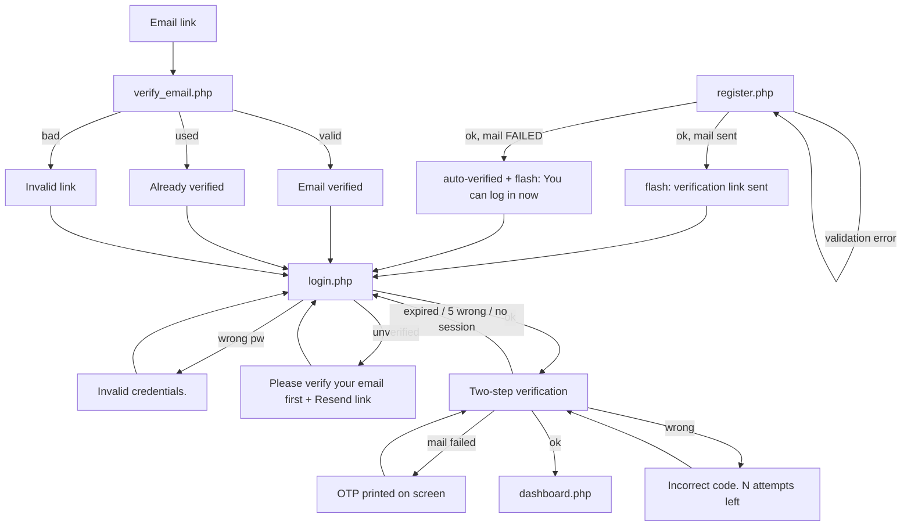
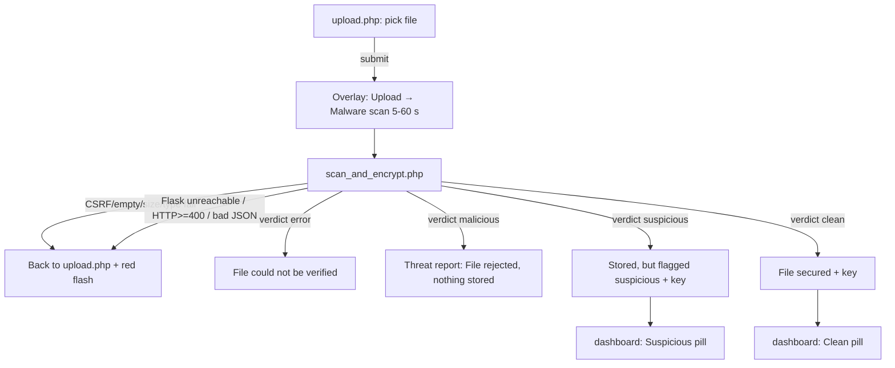
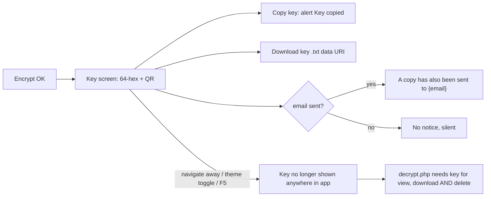
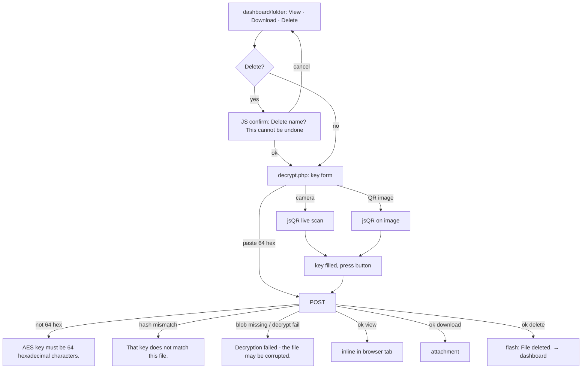

# Cloudie — UI/UX Study (read-only phase)

Date: 2026-10-12 · Branch `docs/audit-cloudie` · Author: Claude Code
Scope: all PHP pages, `includes/header.php`, `footer.php`, `auth_ui.php`, `scan_report.php`, `qr.php`, `mailer.php` (email copy only), `assets/`. Excluded: `.venv`, PHPMailer internals, `jsQR.js`.
Nothing was modified except this file. No GCP, Cloud SQL or VirusTotal calls. No form was submitted. Live check: only the guest pages `/cloudie/`, `login.php`, `register.php` on local XAMPP (desktop + 375 px). Logged-in screens were read from code, not seen live.
Companions: `AUDIT_REPORT.md` (IDs A-xx reused), `AUDIT_CLOUDIE.md`, `STUDY_GUIDE.md`, `DEFENSE_QA.md`, `CLAUDE.md`. Code is ground truth; mismatches are flagged.

---

## 1. Executive summary

**UX health score: 6.5 / 10.** Visually it is the most polished part of the project (one coherent dark/light theme, good empty states, a clear scan report). It loses points on three things: some screens say the opposite of what the system did (A-16), the one-time key screen is easy to destroy by accident, and several copy lines overclaim security.

### 5 biggest UX risks for a live defense demo

| # | Risk | Evidence |
|---|---|---|
| 1 | **The one-time key screen can be destroyed.** It is the response to a POST. Clicking the theme toggle, pressing F5 or Back sends a GET (or re-POSTs). A GET to `scan_and_encrypt.php` just flashes "Invalid request." and redirects. The file is already stored and encrypted and the key is gone (unless the email arrived). F5 re-POSTs and creates a duplicate file with a new key. | `scan_and_encrypt.php:32-36`, `header.php:31-32,663`, `:243-244,256-334` |
| 2 | **A stored *suspicious* file's report says it was rejected and deleted.** Banner: "File rejected — SUSPICIOUS". Footer: "This file was deleted from the server and was not encrypted or stored." The dashboard shows the same file as stored. A PNG upload triggers this (A-04). | `view_report.php:74`, `scan_report.php:91-93,338-344` (A-16) |
| 3 | **The scan wait and its failure path.** The overlay is a time-based guess: "scan" stays active until the page reloads, with no "taking longer than usual" state. Timeout is 60 s (`config.php:23`). A failure shows a raw string such as "Malware scan failed: AI scanner unreachable: …" or "Scanner returned invalid JSON (HTTP 413)". The live services returned 503 earlier today (CLAUDE.md TODO 1). | `upload.php:55,139-160`, `scan_and_encrypt.php:63-67`, `scanner.php:36-45` |
| 4 | **Copy that overclaims security.** "End-to-end AES-256-CBC", "your key never leaves your hands", "strong client-side encryption", "nobody can decrypt your data — not even us". The code encrypts on the server, emails the key and fetches the QR from `api.qrserver.com`. | `register.php:100,109`, `index.php:62,150,266`, `qr.php:35-38` (A-02, A-13) |
| 5 | **Upload page says the wrong thing before the user even starts.** "scanned with the AI malware analyzer first. Only files verified as clean are encrypted…" Reality: VT is first, AI-flagged (suspicious) files are also stored. Limit shown is 50 MB; Flask rejects >25 MB (A-14). The OTP page can print "Email is disabled … `MAIL_ENABLED=false`" and the code on screen (A-05). | `upload.php:12-15,26`, `config.php:74`, `login.php:266-272` |

### 5 strongest UI points to brag about

1. **One design-token system with a working dark/light theme** (cookie-persisted). All pages share `:root` tokens (`header.php:87-106`). The theme toggle changes the entire look, including the report.
2. **A real scan report page:** verdict banner, three-way verdict tiles (combined / AI / VirusTotal), probability bars, per-engine VT list, 32-feature table, indicator list, .txt/.json download (`scan_report.php`, `view_report.php:52-68`). It shows both detectors side by side, which fits the "VT primary, AI secondary" story.
3. **Key-delivery screen:** QR + monospace key + Copy + Download .txt + emailed copy + plain "lose it and the file can't be recovered" warning (`scan_and_encrypt.php:309-331`).
4. **Decrypt screen with QR scan by camera or image upload** (jsQR, client-side), lenient key extraction, clear error text (`decrypt.php:135-155,207-315`).
5. **Careful auth UX:** two-step login with masked email, attempts-left counter, resend cooldown, neutral "resend verification" reply, password show/hide, live strength meter, dirty-state Save button (`login.php:101-109,128-131,166`, `profile.php:335-346,368-403`). Also responsive: sidebar becomes a drawer ≤1000 px and the file table becomes stacked cards ≤700 px (`header.php:309-339`).

---

## 2. Screen inventory

All URLs are relative to `/cloudie/`. "Guest" = not logged in. Pages that need login call `require_login()`, which silently redirects to `login.php` (`auth.php:23-27`).

| # | File | Purpose | Access | Entry points | Exits | Main components | Forms (fields · validation · CSRF) |
|---|---|---|---|---|---|---|---|
| 1 | `index.php` | Landing page. Pitch, "how it works", problem, 3 layers, stats, stack, credits. | Guest + logged-in | Root URL; sidebar brand link `header.php:560` | `register.php`, `login.php`, `upload.php`, `dashboard.php`, `#learn-more`, 3 placeholder social links | Hero with pill, gradient H1, "How it works" card (desktop only), 4 stat tiles, tech badges, credits card, scroll-reveal | None |
| 2 | `register.php` | Sign up | Guest (logged-in → dashboard `:7`) | Sidebar "Sign up", landing CTA, login footer link | `login.php` (flash) | Split card: brand aside + form | `username`, `email` (type=email), `phone` (optional), `password` min 8, `confirm`. Server: required `:22`, `FILTER_VALIDATE_EMAIL :24`, ≥8 chars `:26`, match `:28`, duplicate → `:77`. CSRF `:13,131` |
| 3 | `verify_email.php` | Confirm email link | Anyone with a link | Verification email; link `?uid=&token=` | `login.php` | Centred card with 3 states (success / already / invalid) `:56-85` | None (GET). Token compared with `hash_equals :37`. No expiry. |
| 4 | `login.php` (stage 1) | Username/email + password | Guest | Sidebar, landing, `logout.php`, `require_login` redirect | Stage 2, or error | Split card | `login`, `password`. CSRF `:55,332`. Error "Invalid credentials." `:209` |
| 5 | `login.php` (stage 2) | 6-digit OTP | Guest with `$_SESSION['otp_uid']` | Stage 1 success | `dashboard.php` | OTP input (`pattern [0-9]{6}`, autofocus, `one-time-code`), Resend, Back link, dev-code banner | `otp`; `resend_otp`. CSRF yes. 5 attempts, 10 min TTL, 60 s resend (`config.php:105-107`) |
| 6 | `dashboard.php` | "My encrypted files": list, summary cards, vault search | Logged-in | Login success, sidebar, brand, folder deletes | `upload.php`, `view_report.php`, `decrypt.php?action=view/download/delete`, `folder.php` | 4 summary cards `:95-116`, file table → stacked cards on phone, folder chips, live search `:215-255`, empty states `:118-124,199-203` | None. Search input has no `<form>`. Delete is a GET link with JS `confirm()` `:207-212` |
| 7 | `upload.php` | File picker + progress overlay | Logged-in | Sidebar "Upload & Scan"/"Upload", dashboard button | `scan_and_encrypt.php` (POST) | Dropzone (label wrapping hidden file input), staged overlay `:44-68` | `file` (hidden + required `:28`), CSRF `:19`. No client-side type/size check. |
| 8 | `scan_and_encrypt.php` | Server pipeline + result screens | Logged-in, POST only | `upload.php` form | `upload.php` (on error), `view_report.php`, `dashboard.php` | 4 outcomes: **malicious** report `:91-136`; **error** "could not be verified" `:138-169`; **suspicious** "Stored, but flagged" `:263-274`; **clean** "File secured" `:276-285`. Success pages show pipeline chips `:289-298`, key + QR + buttons `:309-331` | Receives upload; CSRF `:33` |
| 9 | `view_report.php` + `includes/scan_report.php` | Stored scan report | Logged-in, owner only `:34` | Dashboard/folder "Report", key screen "View report" | `dashboard.php`, `?dl=txt`, `?dl=json` | Verdict banner, summary tiles, AI bars, VT counts + engine list, metadata, indicators, features (toggle) | None (GET). Owner check `AND user_id = ?`. |
| 10 | `decrypt.php` | Enter/scan key, then view / download / delete | Logged-in, owner only `:37` | Dashboard/folder action buttons | Inline file (`view`), attachment (`download`), dashboard (`delete`) | Key input (`pattern [0-9a-fA-F]{64}`), camera scan, QR image upload, hints | `aes_key`, `action`, `id`. CSRF `:53,122`. Errors `:60,62,73` |
| 11 | `folder.php` | One folder: list, rename, delete folder, add/remove files | Logged-in, owner only `:10-13` | Sidebar folder link, dashboard folder chip, `create_folder.php` redirect | `dashboard.php` | Folder header + colour icon, rename inline form, file table, collapsible "Add files" panel | `add`, `remove`, `delete_folder`, `rename` (`new_name` max 100). CSRF `:17`. |
| 12 | `create_folder.php` | Handler only, no UI | Logged-in, POST | Sidebar "+" form `header.php:584-599` | `folder.php?id=` or `dashboard.php` (+flash) | — | `folder_name` (HTML max 50, server max 100), `color` radio of 5. CSRF `:11` |
| 13 | `profile.php` | Account details + change password | Logged-in | Avatar menu "My profile" | Same page | Hero (avatar, verified badge, member since, last login), two cards | Details: `username` 3–64, `email`, `phone`, `current_password`. Password: `current`, `new` ≥8, `confirm`, must differ. CSRF `:29`. Separate error vars `$errDetails/$errPass`. |
| 14 | `logout.php` | Destroys session | Any | Avatar menu "Log out" (plain GET link `header.php:686`) | `login.php` | — | — (no CSRF; A-11) |

**Shared shell (`header.php`):** sidebar (logo, "Upload & Scan" button, nav "My files" / "Upload", "My Folders" + add form, "Security → Scan reports", storage meter), topbar (mobile menu button, dashboard-only search, theme toggle, avatar menu), flash area (`:696-706`). `footer.php` only closes tags; there is no footer content.

---

## 3. User flows

### 3.1 Register → verify email → login (password → OTP) → dashboard



| Step | What the user sees (exact string) | Evidence |
|---|---|---|
| Missing fields | "Username, email and password are required." | `register.php:23` |
| Bad email | "Please enter a valid email address." | `:25` |
| Short password | "Password must be at least 8 characters." | `:27` |
| Mismatch | "Passwords do not match." | `:29` |
| Duplicate | "That username or email is already taken." | `:77` |
| DB error | "Could not create your account. Please try again." | `:80` |
| CSRF fail | "Invalid request." | `:14` |
| Success + mail OK | "Account created. We sent a verification link to {email} — confirm it, then log in." | `:62-64` |
| Success + mail failed | "Account created. You can log in now." (account silently auto-verified, A-12) | `:66-71` |
| Verify OK | "Email verified" / "Your address is confirmed. You can now log in to your vault." | `verify_email.php:61-62` |
| Verify again | "Already verified" / "This email address was already confirmed — just log in." | `:70-71` |
| Verify bad | "Invalid verification link" / "This link is invalid or has already been used. Try logging in — if your email still needs verification, you can request a new link there." | `:79-83` |
| Wrong password | "Invalid credentials." | `login.php:209` |
| Unverified | "Please verify your email address first — check your inbox for the link." + "Resend verification email" | `:197,324` |
| Resend reply | "If that account exists and is unverified, a new verification link has been sent." | `:166` |
| OTP page | "Two-step verification" / "We emailed a 6-digit code to a•••@domain." | `:253,258` |
| OTP wrong | "Incorrect code. N attempt(s) left." | `:106` |
| OTP exhausted | "Too many incorrect codes — please log in again." | `:84,104` |
| OTP expired | "That code has expired — please log in again." | `:81` |
| OTP session gone | "Your session expired — please log in again." | `:66,119,127` |
| Resend too soon | "Please wait a moment before requesting another code." | `:131` |
| Resend OK | "A new code has been issued." | `:136` |
| Mail failed | Amber box: "Email is disabled in this environment (`MAIL_ENABLED=false`), so your one-time code is shown here instead:" + 26 px code. The same wording appears in production when SMTP fails (A-05). | `:266-272` |

Edge notes:
- There is no loading state on any auth button (no disable on submit), so double submit is possible.
- On OTP page 2, the browser Back button returns to stage 1; a fresh GET clears `otp_uid` (`:49-52`).
- The verification link has no expiry.

### 3.2 Upload → scan → verdict (clean / suspicious / malicious / error)



| Case | What the user sees (exact) | Evidence |
|---|---|---|
| Helper text | "Files are scanned with the AI malware analyzer first. Only files verified as clean are encrypted with AES-256 and stored." (**inaccurate**) | `upload.php:12-15` |
| Limits | "Allowed: pdf, doc, docx, … rar · max 50 MB" (Flask limit is 25 MB) | `:25-27`, `config.php:74`, A-14 |
| Overlay | "Securing your file", steps Upload / Malware scan ("VirusTotal + AI analysis · usually 5–60 s") / Encrypt ("the key is shown only to you") / Store; "Elapsed N s · keep this tab open" | `upload.php:46-66` |
| Button | "Scan & encrypt" → "Analyzing…" (disabled) | `:35,141` |
| No file picked | Required file input is `hidden`; the browser cannot show its validation bubble (verify live; see Open questions) | `:28` |
| Bad upload | "File upload failed. Please try again." / "File is empty or exceeds the size limit." / "That file type is not allowed." / "Could not save the upload." (red flash on `upload.php`, after a round trip) | `scan_and_encrypt.php:38,44,50,57` |
| Post larger than `post_max_size` (60 MB) | CSRF field missing → "Invalid request." | `:33-35` |
| Scanner down | "Malware scan failed: AI scanner unreachable: {curl error}" | `:66`, `scanner.php:36-37` |
| Flask 413 (>25 MB) | "Malware scan failed: Scanner returned invalid JSON (HTTP 413)." | `scanner.php:43-45` |
| Verdict **error** | Blue banner "File could not be verified" / "Cloudie could not get a reliable verdict for {file} and did not store it. Please try again." + Try again / Back to my files | `:151-161` |
| Verdict **malicious** | Page "Threat report", "Scanned {time} · upload blocked, nothing was stored", .json download, "Upload another file"; red banner "File rejected — MALICIOUS" + reason (e.g. "VirusTotal (primary) flagged the file. Upload blocked."); red alert "This file was deleted from the server and was not encrypted or stored." | `:111-135`, `scan_report.php:92,341-344`, `verdict_engine.py` |
| Verdict **suspicious** | Amber "Stored, but flagged suspicious": "{file} was cleared by VirusTotal, but the AI structural analyzer flagged it. It was encrypted with AES-256 and stored, and is tagged Suspicious in your vault." Chips "Scanned · Suspicious (AI) · Encrypted · Stored". Box "Why is this flagged? … structural features (e.g. embedded JavaScript or auto-run actions) often seen in malicious PDFs. Open it with caution." (wrong when VT had no result, or for a non-PDF) | `:268-273,291-293,301-306` |
| Verdict **clean** | "File secured": "{file} was scanned, verified clean, encrypted with AES-256, and stored." Chip "Clean · {100−P(malicious)}% safe" (uses the AI probability even though VT is primary) | `:280-284,294` |
| Key section (clean + suspicious) | See 3.3 | |

Result screens: the **clean/suspicious success page does not use `scan_report.php`**; the full report is one click away ("View report"). The `$keyHex && $qrSrc` branch inside `scan_report.php:350-376` is therefore never rendered (dead code).

### 3.3 Key delivery (screen, QR, email) and lost key



How the user is told to save it:
- On screen: "Your AES key — Save this key. **You'll need it to view, download, or delete this file.** We never store it — lose it and the file can't be recovered." (`scan_and_encrypt.php:310-313`). Also in the pipeline overlay: "the key is shown only to you" (`upload.php:59`).
- By email (best effort, key in plain text): "Cloudie does not store it — if you lose it, the file cannot be recovered. Keep this email private; anyone with the key can decrypt this one file." (`mailer.php:129-131`). The email body says the file "passed the malware scan" even for a suspicious file (`mailer.php:119`).
- The QR is `` because `endroid/qr-code` is not in `composer.json` (A-02). The key is sent to a third party; the UI does not say so.
- Copy button uses `alert('Key copied to clipboard.')` (`:362`); there is no `.catch`, so on a non-secure origin it fails silently or throws.

If the user loses the key:
- No screen can re-show it. `file_keys` holds only `sha256(key)` and the IV (`scan_and_encrypt.php:218-226`).
- **Even Delete needs the key** (`decrypt.php:160-165` button "Decrypt & delete"; key check `:61`). A file with a lost key cannot be viewed, downloaded or deleted by the user; it only counts toward the 1 GB quota (`config.php:75-76`).
- No "I have saved my key" confirmation gate exists, and no `beforeunload` warning.
- Welcome email repeats the warning (`mailer.php:339-344`).

### 3.4 Decrypt: enter or scan key → view / download / delete



Strings: heading "Decrypt file using AES" (even for delete); "Action: VIEW · File: {name}"; label "Paste your AES key (64 hex chars)"; hint "Or use the QR code you saved at upload time — scan it with your camera or upload the QR image, and the key is filled in for you." (`decrypt.php:111-133`). Button text: "View file" / "Download file" / "Decrypt & delete" (`:160-165`). Errors: `:60,62,73`. QR messages: "Key read from QR — press “View file” to continue." (`:219`); "A QR was detected, but it does not contain a Cloudie key. Still scanning…" (`:241`); "Camera is not available here (needs HTTPS or localhost). Use “Upload QR image” instead." (`:249`); "Could not open the camera — check browser permissions…" (`:263`); "No QR code found in that image…" (`:305`).
Edge: wrong-key attempts are logged (`DECRYPT_FAIL`, `:63`) but not rate-limited (A-07). "View" replaces the page with the file (no in-app chrome, Back returns to the form). There is no loading indicator while a large blob is fetched from GCS and decrypted.

### 3.5 Folders: create, move into, navigate

```mermaid
flowchart TD
  S[Sidebar + button] --> F[Inline form: name, 5 colour dots]
  F -->|ok| FD[folder.php?id=new, empty state]
  F -->|empty or >100 chars| ER[flash on dashboard: Folder name must be 1–100 characters.]
  FD --> AP[Add files to this folder panel] -->|Add| FD
  FD -->|Remove| FD
  FD -->|Rename inline| FD
  FD -->|Delete folder + confirm| DB[dashboard: Folder "x" deleted.]
  DB2[dashboard folder chip] --> FD
```

- Create: sidebar toggle form (`header.php:576-600`). The input is `maxlength=50` (`:586`) but the server allows 100 (`create_folder.php:15`). On failure the user is thrown to `dashboard.php` from any page (`:16-17,29`).
- Empty folder: "This folder is empty / Add files from your vault using the panel below." (`folder.php:184-185`). Add panel with no candidates: "All your vault files are already in this folder." (`:270`).
- Moving files: only from inside the folder page via "Add files to this folder" (collapsed by default). Dashboard rows only show a folder chip; there is no move control, no drag-and-drop.
- Rename with empty/over-long name is silently ignored (`folder.php:38`). Unknown/foreign folder id silently redirects to the dashboard with no message (`:13`).
- Delete folder confirm: "Files will NOT be deleted — they move back to your vault." (`:161`).
- Sidebar empty text: "No folders yet — create one above." (`header.php:608`).

### 3.6 Profile and logout

| Action | Behaviour / strings | Evidence |
|---|---|---|
| Open | Avatar button → menu (name, email, "My profile", "Log out") | `header.php:671-691` |
| Edit details | Save is disabled and reads "No changes yet" until a field changes; amber hint "⚠ Email changed — a verification link will be sent to the new address." | `profile.php:335-346` |
| Details errors | "Username must be 3–64 characters." / "Please enter a valid email address." / "Your current password is incorrect." / "That username or email is already taken." / "Could not save your changes. Please try again." | `:50,52,54,97,100` |
| Details OK | Flash "Profile updated." (fades after 4 s `:413-419`); with email change: "…We sent a verification link to {email} — confirm it before your next login." If mail fails the email is auto-verified with no message (A-12) | `:69-86` |
| Password | Live strength meter ("Too short…", "Weak…", "Okay…", "Strong password.") and match note; errors "Your current password is incorrect." / "New password must be at least 8 characters." / "New passwords do not match." / "New password must be different from the current one." / OK "Password changed." (stays logged in) | `:113-127,377-403` |
| Leave with unsaved edits | Browser `beforeunload` prompt | `:357-359` |
| Logout | GET link, no confirmation; goes to `login.php` with no "logged out" message | `logout.php:3-13` |

### 3.7 View a past scan report

Dashboard/folder "Report" → `view_report.php?id=` (owner only, `:34`). The page shows "Scan report · Uploaded {date}", `.txt` / `.json` / "My files" buttons (`:86-109`), then `scan_report.php`: banner, summary tiles, AI probability bars, VT counts + flagged engines + "View on VirusTotal" link, metadata (MD5, SHA-256, size, "PDF document"/"Non-PDF"), "Suspicious capabilities" list (or "No risky PDF capabilities detected."), key-features table + "Show all 32 features".
Edge cases:
- **Stored suspicious file**: `$rejected = is_clean != 1` (`:74`) → banner "File rejected — SUSPICIOUS" and the false "deleted from the server" alert (U-01).
- **Old rows with no stored report**: `$report = []` (`:45-47`) → "UNKNOWN" banner (blue), 0.00 % probabilities, empty metadata; no explanation.
- **VT not configured/unavailable**: grey note "VirusTotal is not configured for this scan." / "No VirusTotal result was available for this file." (`app.py:387-390`).
- `view_report.php` selects no `verdict` column and relies on the JSON (`:31-32`).
- Wrong/foreign id: flash "File not found." → dashboard (`:41`).

---

## 4. Design system as implemented

### 4.1 Stack and file layout

| Item | Fact | Evidence |
|---|---|---|
| Framework | **None.** Custom CSS. No Bootstrap/Tailwind loaded (confirmed live: no bootstrap stylesheet). Bootstrap-like class names (`row`, `col-lg-*`, `d-flex`, `gap-2`, `mb-3`…) are re-implemented in ~25 lines | `header.php:289-307,346-349`; `index.php:299-360` (adds `col-6`, `px-3`…) |
| Where CSS lives | **Inline `<style>` in `header.php` (~400 lines)**, then per-page `<style>` blocks: `index.php:299-482`, `dashboard.php:55-84`, `folder.php:90-135`, `profile.php:153-189`, `upload.php:70-98`, `decrypt.php:172-183`, `scan_and_encrypt.php:336-357`, `login.php:294-305`, `auth_ui.php:11-104` | |
| `assets/css/style.css` | **Dead file (201 lines).** Not linked by any PHP file (grep: zero references). It is an older light-card theme (`--cl-*` tokens, `.report-tile`, `.cloudie-nav`) | `assets/css/style.css` |
| JS | Vanilla, inline. `assets/js/jsQR.js` only on `decrypt.php:185` | |
| Fonts | Google Fonts: Space Grotesk (headings, buttons), Inter (body), JetBrains Mono (keys, sizes, hashes). Needs internet | `header.php:83-85` |
| Icons | Hand-written inline SVG (stroke 1.6–2.4), no icon font | everywhere |
| Logo | Inline SVG cloud+lock in a cyan→violet gradient square + wordmark "Cloud**ie**" (the "ie" in cyan). No favicon, no `assets/images/` content (folder is empty) | `header.php:132-138,561-565` |
| Viewport | `<meta name="viewport" content="width=device-width, initial-scale=1.0">` | `header.php:81` |

### 4.2 Colour palette (tokens in `header.php:87-106`)

| Token | Dark (default) | Light |
|---|---|---|
| `--ink` page bg | `#0a0e1a` | `#f4f6fb` |
| `--panel` / `--panel-2` | `#0f1426` / `#141b30` | `#ffffff` / `#eef2f9` |
| `--txt` / `--txt-dim` / `--txt-faint` | `#e8ecf6` / `#8a93ad` / `#59617a` | `#13192b` / `#54607a` / `#8a93ad` |
| `--cyan` (brand/primary) | `#27d3e0` (deep `#0fa9c4`) | `#0aa6bd` (deep `#0c8ba0`) |
| `--violet` | `#7b5cff` | `#6a45f5` |
| `--green` (clean) | `#34e0a1` | `#11a974` |
| `--amber` (suspicious) | `#ffc24b` | `#cf8b00` |
| `--red` (malicious) | `#ff5d6c` | `#e23748` |
| Radius / shadow | 18 px / cyan glow | same |

Landing page defines a **second** token set `--lp-*` with `#19e3ff` / `#45a8ff` / `#9b7bff` (`index.php:302-339`), which is slightly different from `--cyan #27d3e0`. The dead `style.css` has a third set (`#19e3ff`, `#6b2bd9`).

**Verdict colours (consistent across dashboard, folder, report, success screens, profile badge):**

| Verdict | Colour | Components |
|---|---|---|
| clean | green | `.verdict.v-clean` `header.php:267`; `.vb-ok`; `.rt-ok`; `.step.done`; `.pf-ok` |
| suspicious | amber | `.v-susp` (defined **twice**, `dashboard.php:79`, `folder.php:111`); `.vb-warn`; `.rt-warn`; `.step.warn`; `.alert-warning` |
| malicious | red | `.vb-danger`; `.rt-danger`; `.alert-danger`. `.v-flag` (`header.php:268`) is **defined but never used**: malicious files are never stored, so no list row can carry it |
| error / unknown | cyan "info" | `.vb-info` `header.php:386-388` |

### 4.3 Typography and spacing
- H1–H5: Space Grotesk, letter-spacing −0.02 em (`header.php:211`). Body 14 px Inter. Labels 13–13.5 px. Smallest text on screen: 11–11.5 px (nav-label, table headers, `.small` 12.5 px).
- Landing hero uses `clamp(2.2rem,5vw,3.6rem)` (`index.php:378`), but `.hero h1{font-size:44px}` also exists in `header.php:274`, which is unused because the landing H1 has its own class.
- Spacing is a mix of px (`header.php`) and rem utilities (`.mb-3 = 1.1rem`, `.mt-4 = 1.6rem`) with many inline `style=""` attributes (report page, folder header, verify page).
- Card padding `26px 28px`; page padding `24px 34px` (18 px on mobile).

### 4.4 Reusable components and where used

| Component | Class(es) | Used on |
|---|---|---|
| Card | `.cl-card` (+ cursor spotlight JS `.cg`, `header.php:485-490,503`) | login/profile/upload/decrypt/report/verify/key screen |
| Primary / outline / danger button | `.btn-cloudie`, `.btn-cloudie-outline`, `.btn-danger` (+ `.btn-sm`) | all pages |
| Sidebar "new" button | `.newbtn` | `header.php:568` |
| Inputs | `.form-control`, `.nav-fi`, `.input-icon` (auth only), `.pw-wrap` (profile only) | duplicates of the same idea |
| Alerts | `.alert-danger`, `.alert-success` in `header.php:248-249`; **`.alert-warning` defined separately** in `login.php:299` and `scan_and_encrypt.php:353` | flash area, forms |
| Verdict pill | `.verdict` + `v-clean`/`v-susp` | dashboard, folder |
| Summary card | `.scard` (+ `.scard-ico`, `.i-green/.i-cyan/…`) | dashboard, folder (**copy-pasted CSS**; folder.php defines it but never renders `.summary`) |
| File type icon | `.ftype` + `t-pdf/t-img/t-doc/t-zip` | dashboard, folder, add panel |
| File table → cards | `.file-table` + `data-label` | dashboard, folder |
| Folder chip / dot | `.folder-chip`, `.nav-fdot` | dashboard, header |
| Storage meter | `.bar i` (turns amber→red ≥80 %) | sidebar |
| Verdict banner | `.vbanner vb-ok/warn/danger/info` | report, error screen |
| Report tile | `.rt rt-ok/warn/danger` | report |
| Probability bar | `.rpt-progress` + `.rpt-bar-red/green` | report only |
| Pipeline chips | `.pipeline .step` | key screen |
| Scan overlay | `.scanov` (+ `.ss-ico` spinner) | upload only |
| Key box / QR | `.key-box`, `.qr-card img`, `.qr-img` | key screen, report (dead branch) |
| Modal | **none**; native `confirm()`/`alert()` instead | `dashboard.php:210`, `folder.php:161,296`, `scan_and_encrypt.php:362`, `scan_report.php:372` |
| Dropdown | avatar menu | `header.php:190-208,513-528` |
| Drawer | mobile sidebar | `header.php:309-318,529-548` |

### 4.5 Inconsistencies (same thing, different styling)
1. **Password show/hide toggle**: `.pw-toggle` styled twice (`auth_ui.php:85-90`, `profile.php:175-179`) plus two JS copies.
2. **Form field wrapper**: `.field` / `.input-icon` on auth pages vs `.mb-3` + bare `<label>` on profile/decrypt (`.cl-card label` rule). Different label sizes (13 px vs 13.5 px).
3. **Key copy**: `copyKey()` (`scan_and_encrypt.php:360`) and `rptCopyKey()` (`scan_report.php:370`) are two implementations (the second is dead).
4. **Page headers**: dashboard `<h2>My encrypted files</h2>` (`:87`); report `<h2 style="font-size:1.25rem">` inline (`view_report.php:88`); profile `<h2 class="mb-3">`; upload/decrypt use `<h3>` inside the card. No page has an `<h1>` after login.
5. **Dashboard summary cards say one thing, rows another**: card label "Suspicious (AI flagged)" (`dashboard.php:104`), row pill "Suspicious".
6. **Two nav items for one page**: "My files" and "Security → Scan reports" both go to `dashboard.php`, and both highlight as active (`header.php:573,626`).
7. **Colour sets**: `--cyan #27d3e0` vs `--lp-accent #19e3ff`; the landing page and the app look slightly different in light mode.
8. **Native dialogs** (`alert`/`confirm`) vs custom overlay and flash alerts.
9. **Folder name length**: 50 (HTML) vs 100 (server).
10. `fmt_size()` is defined in both `dashboard.php:33` and `folder.php:68`, while `cl_fmt_bytes()` exists in the header (three helpers for the same job).

---

## 5. State coverage matrix

H = handled, P = partial, M = missing, – = not applicable.

| Page | Empty | Loading / wait | Success | Validation error | Server error (Flask / mail / DB) | Session expired |
|---|---|---|---|---|---|---|
| `index.php` | – | – (scroll-reveal only) | – | – | – | – |
| `register.php` | – | **M** (no disabled/spinner) | **H** flash `:62-72` | **H** server messages + HTML5 | **P** DB: generic msg `:80`; mail fail → silent auto-verify (A-12) | – |
| `login.php` stage 1 | – | **M** | **H** | **H** "Invalid credentials." | **P** mail fail → OTP on screen with dev text (A-05); DB down → uncaught PDOException = blank HTTP 500 (`db.php:28`) | – |
| `login.php` OTP | – | **M** | **H** | **H** attempts-left, expired, exhausted | **P** same as above | **H** "Your session expired — please log in again." `:66` |
| `verify_email.php` | – | – | **H** | **H** invalid/used link | **P** DB error uncaught | – |
| `dashboard.php` | **H** `:118-124`, search `:199-203` | – (server-rendered; no pagination for large vaults) | **H** flash | – | **M** query error uncaught → 500 | **P** silent redirect to login, no message, no return URL (`auth.php:23-27`) |
| `upload.php` | – | **H** overlay; **P** (never completes encrypt/store, no "slow" state) | – | **P** all checks are server-side after a full upload; no client check; hidden required input | **P** raw "Malware scan failed: …" flash | **P** POST lost silently |
| result screens | – | – | **H** clean / suspicious / malicious | – | **P** Flask down = raw flash on upload page; verdict `error` = **H** friendly screen | **P** |
| key screen | – | – | **H** | – | **P** email failed = no notice (line just absent `:314-316`) | – |
| `decrypt.php` | – | **M** (no feedback while fetching/decrypting) | **H** | **H** 3 key messages + QR messages | **P** "Decryption failed - the file may be corrupted." `:73` (also covers missing GCS blob) | **P** silent |
| `folder.php` | **H** empty + add-panel empty | – | **P** no success flash for add/remove/rename | **P** rename error ignored silently `:38` | **P** none (uncaught) | **P** silent; bad id → silent redirect `:13` |
| `profile.php` | – | – | **H** flash + fade | **H** two separate error areas | **P** | **P** |
| `view_report.php` | **P** old row with no report → "UNKNOWN" banner, zeros, no explanation | – | **H** | – | **P** | **P** |

Cross-cutting gaps:
- There is no custom 404/500 page.
- There is no idle-timeout message.
- `display_errors` defaults to ON (`config.php:111`), so a local PHP warning would print into the page during a demo (A-23).

---

## 6. Copy and language

### 6.1 Language, tone, terminology
- **Language:** the whole UI and all emails are English. There is no Malay copy. The only locale hint is the Malaysian phone placeholder `012-3456789` (`register.php:156`, `profile.php:247`). Consistent.
- **Tone:** friendly and confident ("Get started — it's free", "Measured, not assumed", "Securing your file"). The landing page has marketing-style claims; the app screens are plainer.
- **"verdict" vs "status":** "Verdict" is used consistently (dashboard column, report banner, summary tiles, chips). "Status" is not used. OK.
- **"key" vs "password":** "password" = login credential; "AES key" / "decryption key" / "key" = file key. Good separation. Minor variants: "Your AES key" (`scan_and_encrypt.php:310`), "Your AES-256 decryption key" (`scan_report.php:353`), "AES key QR" (alt). Decrypt page title says "Decrypt file using AES" even for View and Delete.
- **"files" vs "vault":** "My files", "My encrypted files", "your vault", "Search your encrypted vault…", "Your vault is empty". Mixed but understandable.
- **Detector names vary:** "AI malware analyzer", "AI structural analyzer", "Random Forest analyzer", "AI (Random Forest)", "ML model". Worth fixing to one term plus "(Random Forest)".
- **Is "suspicious" explained?** Only on the post-upload screen (`scan_and_encrypt.php:301-306`). The dashboard card says "Suspicious (AI flagged)" and the pill just says "Suspicious"; no legend or tooltip. A user who returns later has no definition.
- **Button labels:** "Upload & Scan" (sidebar) vs "Upload" (nav) vs "Scan & encrypt" (form) vs "Analyzing…". Acceptable.

### 6.2 Accuracy against the real logic (flag = overclaim or wrong)

| Where | Text | Reality | Sev |
|---|---|---|---|
| `upload.php:12-15` | "scanned with the AI malware analyzer first. Only files verified as clean are encrypted with AES-256 and stored." | VT first (primary); suspicious (AI-flagged) files are also encrypted and stored (`scan_and_encrypt.php:171-172`) | High |
| `index.php:22-25` | "scans every upload with an AI malware analyzer trained on thousands of PDF samples… Only you, with your key, can read it back." | VT is primary and the AI is only meaningful for PDFs. The server holds the key in memory during encryption and emails it | Med |
| `index.php:58` | "any PDF, image, document, or archive." | True for upload; AI score on non-PDFs is meaningless (A-04) | Med |
| `index.php:62` | "Without it, nobody can decrypt your data — not even us." | Not zero-knowledge: key passes through server memory and email (A-13) | High |
| `index.php:126` | "extracts 32 structural features from each PDF as a supporting signal" | Correct (32, supporting) | OK |
| `index.php:138` | "cross-checks the AI result against VirusTotal… Agreement raises confidence; disagreement is surfaced as a fusion signal." | Roughly right (disagreement → suspicious). VT is described as secondary here ("corroboration") while the same page says VT is primary at `:59` | Low |
| `index.php:150` | "Clean files are encrypted in memory… You hold the key — without it, the data cannot be decrypted by anyone, including the server." | Suspicious files are encrypted too. "including the server": the server temporarily has the key | Med |
| `index.php:266` | "strong **client-side** encryption" | Encryption runs on the server (`aes.php`) | **High** |
| `register.php:100` | "your key never leaves your hands" | Emailed to the user and sent to `api.qrserver.com` inside the QR URL | High |
| `register.php:109` | "**End-to-end** AES-256-CBC" | Server-side encryption; not E2E | **High** |
| `login.php:237` | "AES-256-CBC, keys held by you" | OK (only a hash is stored) | OK |
| `dashboard.php:99` | "Clean (VirusTotal + AI)" | Also "clean" when VT was unavailable and AI-only said clean (A-15) | Med |
| `scan_and_encrypt.php:270` | "was cleared by VirusTotal" | Also printed when VT returned no result (verdict engine note says so, the screen does not) | Med |
| `scan_and_encrypt.php:282` | "verified clean" | Same VT-unavailable path | Med |
| `scan_and_encrypt.php:294` | "Clean · 98% safe" | Derived from the AI probability, not from VT | Med |
| `scan_and_encrypt.php:303-305` | "structural features (e.g. embedded JavaScript or auto-run actions) often seen in malicious PDFs" | For a PNG/DOCX flagged by the model this explanation is nonsensical (A-04) | Med |
| `scan_report.php:102` | "Passed all detectors and stored with AES-256-CBC encryption." | Shown only when `combined.reason` is empty (rare) | Low |
| `scan_report.php:341-344` | "This file was deleted from the server and was not encrypted or stored." | **False** for stored suspicious files (A-16) | **High** |
| `mailer.php:119` | key email: "passed the malware scan" | Also sent for suspicious files | Low |
| `app.py` reason (shown in banner) | "Neither VirusTotal nor AI flagged the file." | Also when VT returned nothing but AI was clean; the VT tile does show the note | Med |

Non-PDF behaviour in the UI: the report labels the file "Non-PDF" (`scan_report.php:268`) but still draws AI verdict, probabilities and 32 feature rows (mostly zeros), with no "AI analysis applies to PDFs only" note.

### 6.3 Placeholder / leftover text
- `index.php:271` `github.com/your-username`, `:275` `linkedin.com/in/your-handle`, `:279` `mailto:you@example.com` (A-29).
- `login.php:340`, `register.php:147` placeholder `you@example.com` (acceptable as an input hint).
- `login.php:268` shows developer text "`MAIL_ENABLED=false`" to end users.
- `index.php:220` badge "Bootstrap" although Bootstrap is not used.
- `index.php:290` "Year 2026" is hard-coded; `index.php:289` "Faculty: Computer & Math Sciences" (check against thesis cover).
- No lorem, no TODO/FIXME in rendered PHP (grep).
- `header.php:289` code comment "used by your pages" (not user-visible).

---

## 7. Accessibility and responsiveness

| Area | Finding | Evidence |
|---|---|---|
| Labels | **No `<label for>` pairs anywhere** (confirmed live on `login.php`: `for=""` on both labels, username input has no id). Screen readers will announce unlabeled edit fields. Dashboard search has only a placeholder, no label/aria-label | `login.php:335,345`, `register.php:134-177`, `profile.php:233-290`, `decrypt.php:126`, `header.php:659` |
| Icon buttons | Menu button and password toggles have `aria-label`. **Theme toggle** (`<a title>`) and **avatar** (`title`) have no accessible name. Folder "+" has `title` only | `header.php:653,663,674,578` |
| Alt text | QR images have alt ("AES key QR"); decorative SVGs have no `aria-hidden`. Logo has no text alternative (wordmark next to it) | `scan_and_encrypt.php:319` |
| Headings | After login there is **no `<h1>`**. Auth pages put the aside `<h2>` before the `<h1>` in the DOM (live: `H2:Welcome back` then `H1:Log in`). Landing has 1 H1, then H4 "How it works" before H2s | `login.php:225,311`, `index.php:53-56` |
| Landmarks | `<aside>`, `<nav>`, `<main>` present. No `<header>`/`<footer>`; no skip link | `header.php:559,572,651` |
| Keyboard focus | `.form-control:focus` has a visible cyan ring. `.btn` and nav links rely on browser default; `.umenu-panel` links are focusable only while open (pointer-events none, but still in tab order when closed: `opacity:0`). Dropzone is a `<label>` around a hidden input, so keyboard users cannot focus the file input (it is `hidden`) | `header.php:227,195-200`, `upload.php:21-28` |
| Escape | Closes the user menu and the mobile drawer; no focus trap in the drawer | `header.php:525-547` |
| Colour contrast (computed) | Dark theme: verdict pills pass (green 8.6:1, amber 8.6:1, red 5.3:1); `--txt-faint` on panel **2.97:1 (fails 4.5)**. Light theme: green pill **2.67**, amber pill **2.50**, cyan links/key text **2.92**, `--txt-faint` **3.06**, red pill 3.64 — all below 4.5:1 for small text | tokens `header.php:87-106` |
| Colour-only meaning | Verdict pills carry both an icon and a word, so they pass. The folder colour (5 hues) is decorative but the name is also given. The probability bars carry numeric labels. The storage meter turns amber/red with text percent beside it. OK | `dashboard.php:157-163` |
| Motion | `prefers-reduced-motion` respected on the landing page only; overlay spinner and hover-lift ignore it | `index.php:477-481` |
| Viewport meta | Present | `header.php:81` |
| Dashboard on mobile | ≤1000 px sidebar → drawer; ≤700 px table → stacked cards with `data-label`; summary cards 1 column; action buttons wrap. No horizontal scroll measured on the guest pages (375 px: `scrollWidth 375`). Logged-in pages not seen live | `header.php:309-339`, `dashboard.php:82-83` |
| Report on mobile | `.rpt-grid-4` → 2 cols (≤780) → 1 col (≤520); summary 3 → 2 → 1; the metadata table has `white-space:nowrap` on `th` (36 % width) so MD5/SHA-256 wrap via `word-break` only on `.mono` | `header.php:352-361,411,414` |
| Key/QR screen on mobile | Single centred column; QR 240 px; key box wraps (`word-break:break-all`); buttons wrap with `gap-2`. Fine | `header.php:285-287` |
| Register on mobile (live) | Password and Confirm sit side by side at 375 px, so placeholders are cut ("Min. 8 c…", "Repeat p…") and the submit button touches them (no margin: `margin-bottom:0` on both fields, `auth_ui.php:97`) | `register.php:160-185` |
| Small text | Smallest rendered font 11.5 px (nav labels, tables) | live measure |

---

## 8. Trust and security UX

What the user actually sees in each case you listed:

| Topic | What is on screen | Gap |
|---|---|---|
| **Encryption** | Pitch "AES-256-CBC" everywhere; storage meter labels "Encrypted storage … · AES-256-CBC"; summary card "Encrypted at rest (AES-256-CBC)"; overlay "the key is shown only to you". No statement that encryption happens on the server. | "End-to-end" / "client-side" wording (§6.2) |
| **Key custody** | "We never store it — lose it and the file can't be recovered." (clear and honest) | The key is also emailed in clear and the QR is rendered by a third-party site (A-02); neither is disclosed on the key screen. No "I saved it" gate (U-13) |
| **Scan limits** | Landing says "trained on thousands of PDF samples", report shows "Non-PDF" label | There is no on-screen statement that the AI is PDF-specific, that VT can be down, or what "suspicious" means long-term |
| **VirusTotal sharing** | Nothing. The upload page never says the file is uploaded to VirusTotal (public sharing) | A-13: add a one-line notice before submit |
| **On-screen OTP fallback (A-05)** | After a correct password, if SMTP fails the user gets the amber box "Email is disabled in this environment (`MAIL_ENABLED=false`), so your one-time code is shown here instead:" with the code | Looks like a bug to examiners and means password alone is enough during an SMTP outage |
| **Stored suspicious shown as "rejected" (A-16)** | Dashboard: amber "Suspicious" pill, file listed and downloadable. Click "Report": amber banner "File rejected — SUSPICIOUS" + alert "This file was deleted from the server and was not encrypted or stored." | Direct contradiction on two screens (U-01) |
| **PNG/non-PDF scored by AI (A-04)** | Upload of a VT-clean PNG: Flask scores it (measured 0.84) → "Stored, but flagged suspicious", chip "Suspicious (AI)", box "…often seen in malicious PDFs…". Report says "Type: Non-PDF" next to a 84 % "Probability malicious" bar and a table of zero features | Looks like a false positive on a harmless image (U-09) |
| **Size-limit mismatch (A-14)** | Upload page: "max 50 MB". A 30 MB file passes PHP, Flask returns 413 (non-JSON) → flash "Malware scan failed: Scanner returned invalid JSON (HTTP 413)." | Wrong limit + opaque error (U-06) |
| **Verdict error** | "File could not be verified … did not store it. Please try again." | Good; fail-closed. (Contrast: VT-down + AI-clean is stored as clean, A-15, with no on-screen hint.) |
| **Wrong key** | "That key does not match this file." and the attempt is logged | No rate limit (A-07); no "stored" integrity message (A-09). |
| **Email verified / 2FA** | Visible and clear (OTP step, verified badge) | Good trust signal |
| **Public Flask** | n/a in UI | A-03 |

---

## 9. Thesis UI cross-check

Source: `FYP_THESIS_formatted.docx` text (3.3.7 "User Interface", 4.3 "User View", Table 3.9). **Only captions and text were compared; the figure images were not opened.** Several figure captions inside the thesis are mis-numbered (e.g. 3.3.7 images are all captioned "Log in interface"; "Figure 4.9" appears twice; "Figure 4.6" caption text says "Figure 4.5").

### 9.1 Screens described vs code

| Thesis | Says | Code | Verdict |
|---|---|---|---|
| 4.3.1 Fig 4.1 Landing | entry point to login or register | `index.php` is a 6-section marketing page with stats/tech stack/credits | Matches; thesis undersells it |
| 4.3.2 Fig 4.2 Register | "name, email, password and other details" | username, email, phone (optional), password, confirm; sends verification link | Matches; add email-verification step to text |
| 4.3.3 Fig 4.3 Login | username + password → dashboard | username **or email** + password → OTP → dashboard | Text skips OTP here (4.3.4 covers it) |
| 4.3.4 Fig 4.4 "Dashboard interface" | OTP page | OTP page. **Caption wrong** (says Dashboard) | Caption fix |
| 4.3.5 Fig 4.5 Dashboard | "uploading, scanning, encrypting, decrypting, downloading, deleting" | Dashboard lists files, summary cards, search, folder chips, Report/View/Download/Delete. Scanning/encrypting happen on the upload route | Reword |
| 4.3.6 Fig 4.6 Profile | "view personal info and update their password" | Also edits username/email/phone and re-verifies new email | Matches (partial) |
| 4.3.7 Fig 4.7/4.8 Upload | "users select a **PDF** file" | Dropzone accepts 14 extensions (`config.php:77-78`) | **Mismatch** (limit vs behaviour) |
| 4.3.7 text | VT and AI "in parallel" | Sequential in one request (audit §5 #5); overlay shows one "Malware scan" step | Mismatch |
| 4.3.7 Fig 4.9 clean result "presented in a table listing file name, hash, size, type, AI verdict, VirusTotal and analysis date" | | Code: banner + 3 tiles + bars + VT counts + metadata table (+ features, indicators). Analysis date is "Uploaded {date}" in the page header, "Last analysed" is VT's date | Differs in layout; no single table |
| 4.3.7 "Scan report download" | | `.txt` and `.json` from `view_report.php:52-68`; threat page offers only `.json` | Matches |
| 4.3.7 Fig 4.10/4.11 flagged/malicious | "cannot proceed to encryption or be stored" | Red banner "File rejected — MALICIOUS" + "deleted from the server" | Matches |
| 4.3.8 Fig 4.12/4.13 Encryption | "After a file has been confirmed clean, the user can **proceed to encrypt**… key stored in file_keys" | Encryption is automatic, no button. Only `sha256(key)` + IV stored (A-20 #12) | Mismatch |
| 3.3.7.5/3.3.7.6 | "Generate Key" step / encryption interface | no such step | Mismatch (Table 3.9 test 9) |
| 4.3.9 Fig 4.15 Decrypt | key paste or QR scan; failed attempts logged | camera scan + QR image upload + paste; `DECRYPT_FAIL` logged | Matches |
| 4.3.10 Fig 4.18/4.19 | "select files … delete them" | per-row Delete → JS confirm → key form; needs the key | Matches; mention key required |
| 4.4.7 / 5.1 "Only clean files stored" | | clean **and** suspicious stored | Mismatch (UI shows "Stored, but flagged suspicious") |
| 3.3.5 "alerts by email or text" | | UI report only | Mismatch |

### 9.2 In code but not shown/described in the thesis
- `verify_email.php` (3 states) and the verification email; "Resend verification email".
- **Folders** (sidebar create form, colours, `folder.php`, rename, add/remove, chips), vault search, storage meter, summary cards.
- **Suspicious** result screen "Stored, but flagged suspicious" and the "Why is this flagged?" box.
- **Verdict error** screen "File could not be verified".
- Scan overlay with elapsed timer (thesis 3.3.7.4 describes an "analysing" mock-up only).
- Dark/light theme toggle, avatar menu, mobile drawer.
- QR image upload on the decrypt page; `.txt` report; "Download key (.txt)".
- Welcome / key / OTP emails (copy in `mailer.php`).
- Dev-mode OTP-on-screen box (not for the thesis, but examiners may see it).

---

## 10. Defense demo script (5–7 minutes)

**Prep (day before / 30 min before):**
- Check Cloud SQL, `cloudie-php` and `cloudie-flask` are up (CLAUDE.md TODO 1: 503 on 2026-10-12). Open `…/health` of Flask one minute before to warm it.
- Create the demo account in advance and verify its email. Keep the Gmail inbox open for the OTP.
- **Samples:** (1) `clean.pdf`: a small, boring text PDF that you have already uploaded once (check P(malicious) < 0.5 and VT clean); (2) `eicar.txt`: standard EICAR string in a `.txt` (allowed type; pre-test that VT flags it, A-01); (3) a non-PDF only if A-04 is fixed. If it is not fixed, **skip the PNG live** and use the screenshot/Q&A answer instead.
- Do not click the theme toggle, F5 or Back on a key screen. Pick light or dark beforehand.
- Pre-record a 60 s screen capture of the full upload flow as a fallback.

| # | Min | Click path | Say | Avoid |
|---|---|---|---|---|
| 1 | 0:00 | `index.php`: hero → "How it works" card | "Three layers: VirusTotal is the primary verdict, my Random Forest is a second signal for PDFs, then AES-256-CBC." | Do not read "End-to-end"/"not even us" lines; scroll quickly past the Credits placeholders |
| 2 | 0:45 | Log in → password → **OTP** from email | "Two-step login; code expires in 10 min, 5 tries." | Do not trigger a mail failure |
| 3 | 1:30 | Dashboard: summary cards, search "pdf", mobile width optional (drawer + cards) | "Every file carries a verdict. Suspicious means VT was clean but the AI flagged it." | Do not open the sidebar "Scan reports" (same page as My files) |
| 4 | 2:00 | Upload `clean.pdf` → overlay | "Upload, scan (VT + AI, 5–60 s), encrypt, store." Narrate while waiting | Do not claim "in parallel"; avoid files > 20 MB |
| 5 | 3:00 | Key screen: key + QR + Copy + Download + email | "The key is shown once and emailed; we only keep its SHA-256 hash. Lose it and the file is unrecoverable." | **Do not touch the theme toggle/F5/Back** on this screen. Do not claim zero-knowledge |
| 6 | 3:45 | "View report": banner, VT tile vs AI tile, 32 features, download `.txt` | "VT is primary, the AI is secondary and shows its probability and the structural indicators." | Skip this on a suspicious file (A-16 text) |
| 7 | 4:30 | Upload `eicar.txt` → Threat report | "VirusTotal flags it → blocked, nothing stored, cleartext deleted." | Only if pre-tested (A-01) |
| 8 | 5:15 | Dashboard → View on `clean.pdf` → paste key (or scan QR from phone) → file opens; then show wrong key message | "Key hash is checked first, wrong attempts are logged." | Do not delete the demo file |
| 9 | 6:00 | Folders: create "Thesis", add file, rename | "Per-user folders, owner-checked." | |
| 10 | 6:30 | Profile: show strength meter, then close | "Password change, re-verification on email change." | Do not change email (mail dependency) |

Fallback lines: scan fails → "Flask is a separate Cloud Run service; cold start can exceed the 60 s timeout; the system fails closed and stores nothing." VT down → say plainly: "it degrades to AI-only; policy for unverified files is a design decision (A-15)."

---

## 11. Prioritised UI/UX backlog (do NOT implement yet)

Severity: High / Med / Low. Effort: S ≤ 1 h, M ≤ half day, L > 1 day. "Thesis" = needs a thesis edit as well.

| ID | Sev | Page | Problem | Fix | Eff | When | Thesis |
|---|---|---|---|---|---|---|---|
| U-01 | **High** | `view_report.php`, `scan_report.php` | Stored suspicious file shown as "File rejected" with "deleted from the server" (A-16) | In `view_report.php:74` set `$rejected=false` for stored rows; show verdict banner with `verdict` from JSON; keep the red alert only on the threat page | S | **Before defense** | No |
| U-02 | **High** | `scan_and_encrypt.php` key screen | Theme toggle/F5/Back lose the one-time key; F5 re-POST duplicates the file | Hide/disable theme toggle on that page (or apply theme via JS without navigation); add `beforeunload` warning; add "I have saved my key" checkbox that enables "Go to my files"; PRG is not possible because the key must not be persisted | S–M | **Before defense** | No |
| U-03 | **High** | `header.php:31-32` | Theme toggle strips the query string; on `folder.php`, `view_report.php`, `decrypt.php` it redirects to the dashboard ("Invalid request") and the theme is not applied (the page script exits before `header.php`) | Keep `$_SERVER['QUERY_STRING']` in the link and set the cookie before page logic (small `theme` handler in `auth.php`/`config.php`) | S | **Before defense** | No |
| U-04 | **High** | `index.php`, `register.php` | Overclaims: "client-side encryption" `:266`, "End-to-end" `register.php:109`, "never leaves your hands" `:100`, "not even us" `index.php:62,150` | Reword: "AES-256-CBC encryption on the server; only a hash of your key is stored" | S | **Before defense** | Check thesis for same phrases |
| U-05 | **High** | `upload.php:12-15` | Wrong helper text (AI first; only clean stored) | "VirusTotal checks the file first, then Cloudie's AI (PDF only). Malicious files are blocked; clean and AI-flagged files are encrypted and stored." Add "Files are sent to VirusTotal for scanning." (A-13) | S | **Before defense** | Yes (wording) |
| U-06 | **High** | `upload.php`, `config.php:74`, `scanner.php` | Limit shown 50 MB vs Flask 25 MB; 413 → "Scanner returned invalid JSON" (A-14) | Set one limit (25 MB) in config + text; JS pre-check of size/extension; map 413 to "File is too large (max 25 MB)" | S | **Before defense** | Minor |
| U-07 | **High** | `scan_and_encrypt.php:66`, `scanner.php` | Raw technical scanner error shown to users | Friendly: "The scanner is not responding. Your file was not stored. Try again in a minute." + log detail; add Retry button | S | **Before defense** | No |
| U-08 | Med | `upload.php:28` | Required file input is `hidden` → submit with no file may be blocked with no message (verify live) | Use a visually-hidden (not `hidden`) input or JS check with inline message | S | **Before defense** | No |
| U-09 | Med | `scan_report.php`, `scan_and_encrypt.php:301-306` | Non-PDF shows AI verdict/probability/zero features, and the "malicious PDFs" explanation (A-04) | For `is_pdf=false` replace AI tiles with "AI analysis applies to PDF files only"; fix Flask gate (A-04) | S (UI) | **Before defense** | Yes (5.3) |
| U-10 | Med | `scan_and_encrypt.php:294` | "Clean · N% safe" derives from AI only | Show "VirusTotal 0/N engines · AI P=…%" | S | **Before defense** | No |
| U-11 | Med | `login.php:266-272` | OTP printed with dev text "MAIL_ENABLED=false" in production (A-05) | Fail closed: "We couldn't send the code. Try again." Dev banner only when `MAIL_ENABLED=false` **and** a dev flag | S | **Before defense** | Minor |
| U-12 | Med | `upload.php:139-160` | Overlay never shows encrypt/store progress, no "taking longer", no abort; timeout 60 s equals the stated upper range | Add "Still scanning…" at 30 s, a Cancel link, and set the text "up to 60 s" | M | Before (light) / future | No |
| U-13 | Med | key screen, `decrypt.php` | No "key saved" gate; delete also needs the key, so a lost-key file is stuck | Add the confirm checkbox (U-02); explain on the key screen "You also need the key to delete"; future: owner-authenticated delete without key | S / M | Before (copy) / future | Yes if delete-without-key is built |
| U-14 | Med | `qr.php`, key screen | Key goes to `api.qrserver.com`; email has the key in clear; neither is disclosed (A-02) | Install `endroid/qr-code` or a JS QR lib; add the sentence "A copy is emailed to you" to the screen (already shown when sent) | S–M | **Before defense** | Yes (custody) |
| U-15 | Med | all forms | Labels not bound to inputs; search has no label | Add `id` + `for`, `aria-label` on search, theme toggle and avatar | S | Before (cheap) | No |
| U-16 | Med | tokens | Light-theme contrast: amber pill 2.5, green 2.67, cyan text 2.92, faint text 3.06; dark faint 2.97 | Darken `--amber/--green/--cyan` in light theme; lighten dark `--txt-faint` | S | Future | No |
| U-17 | Med | `login.php`, `register.php` | Heading order (aside `<h2>` before `<h1>`); no `<h1>` in app pages | Make the aside title a `<p>`/styled div; add visible/`sr-only` `<h1>` per page | S | Future | No |
| U-18 | Med | `dashboard.php` | "Suspicious" has no explanation for returning users | Tooltip/legend: "VirusTotal clean, AI flagged structural features. Stored, open with caution." | S | **Before defense** | No |
| U-19 | Low | `header.php:573,626` | "My files" and "Scan reports" both → dashboard and both active; "Upload & Scan" and "Upload" duplicate | Remove "Scan reports" (or build a real list) and the duplicate nav entry | S | **Before defense** | No |
| U-20 | Low | `index.php:271,275,279` | Placeholder GitHub/LinkedIn/email (A-29) | Real URLs or remove | S | **Before defense** | No |
| U-21 | Low | `index.php:220` | "Bootstrap" badge but custom CSS | Replace with "Custom CSS" or remove (check thesis Table 3.2) | S | Before | Maybe |
| U-22 | Low | `register.php:160-185` | Mobile: cut placeholders and no gap above the button | Stack password fields ≤480 px; add margin | S | Future | No |
| U-23 | Low | `dashboard.php:210`, `scan_and_encrypt.php:362` | Native `alert`/`confirm` break the design; clipboard has no error path | Inline toast / small modal; `.catch` fallback with "select and copy" | S–M | Future | No |
| U-24 | Low | `auth.php:23-27` | Session expiry gives no message or return URL | Flash "Your session expired. Please log in again." + `?next=` | S | Future | No |
| U-25 | Low | global | No 404/500 pages; DB failure = blank 500; `display_errors` default on (A-23) | Add error pages / try-catch in `db()`; default `DISPLAY_ERRORS=0` | M | Future | No |
| U-26 | Low | `folder.php:38,13` | Rename/unknown-folder fail silently; no success flash | Flash messages | S | Future | No |
| U-27 | Low | `header.php:586` vs `create_folder.php:15` | Folder name limit 50 vs 100; create errors bounce to dashboard | Use 100 in the form; return to referrer | S | Future | No |
| U-28 | Low | `decrypt.php:111` | Title "Decrypt file using AES" for delete | "Enter your key to {view/download/delete} {file}" | S | Future | No |
| U-29 | Low | CSS structure | Duplicated CSS (`.scard`, `.v-susp`, `.pw-toggle`, `.alert-warning`), dead `style.css`, unused `.v-flag`/`.success-banner` | Move shared rules into one `assets/css/app.css`, delete dead files | M | Future | No |
| U-30 | Low | `dashboard.php` | No pagination; client-side search only; no sort | Pagination/sort | M | Future | No |
| U-31 | Low | global | No favicon, empty footer (no privacy/VT-sharing note) | Add favicon + one-line footer | S | Future | No |
| U-32 | Low | `index.php`, `scan_and_encrypt.php`, `mailer.php:119` | Detector naming varies; key email says "passed the malware scan" for suspicious | Use one name ("AI analyzer (Random Forest)"); adapt the email sentence | S | Future | No |
| U-33 | Low | `scan_and_encrypt.php:282,270` | "verified clean"/"cleared by VirusTotal" when VT returned nothing (A-15) | Use the VT tile status in the sentence ("VirusTotal: no result") | S | Before | Yes (Q&A) |

---

## 12. Open questions

1. **Hidden required file input (`upload.php:28`)**: does Chrome silently block submit with no file? (Expected, but I could not test: logged-in pages were not opened.)
2. **F5/Back on the key screen**: confirm live that the result is "Invalid request" (GET) or a duplicate file (re-POST). The code path is clear but I did not run it (it needs an upload, which triggers Flask/VT).
3. **Logged-in screens were never seen live**: dashboard, report, key screen, decrypt, folder and profile layouts at 375 px are judged from CSS only.
4. **Which build is deployed?** Live services returned 503 on 2026-10-12, so the deployed UI strings may differ from this tree.
5. **Does the thesis figure set (images) match these screens?** Only text/captions were compared.
6. **Is `assets/css/style.css` referenced in any thesis figure** (the "cyan/violet wave-on-dark mockups" comment)? If so the thesis mock-ups come from the old theme, not the current one.
7. **Policy question for the supervisor:** show unverified (VT unavailable) files as *clean* (current) or *suspicious*? It changes U-33.
8. **Should lost-key files be deletable by the owner without the key?** It is a security vs usability decision (U-13).
9. Is the `Faculty` / `Year 2026` text on the landing page right for the cover page?
